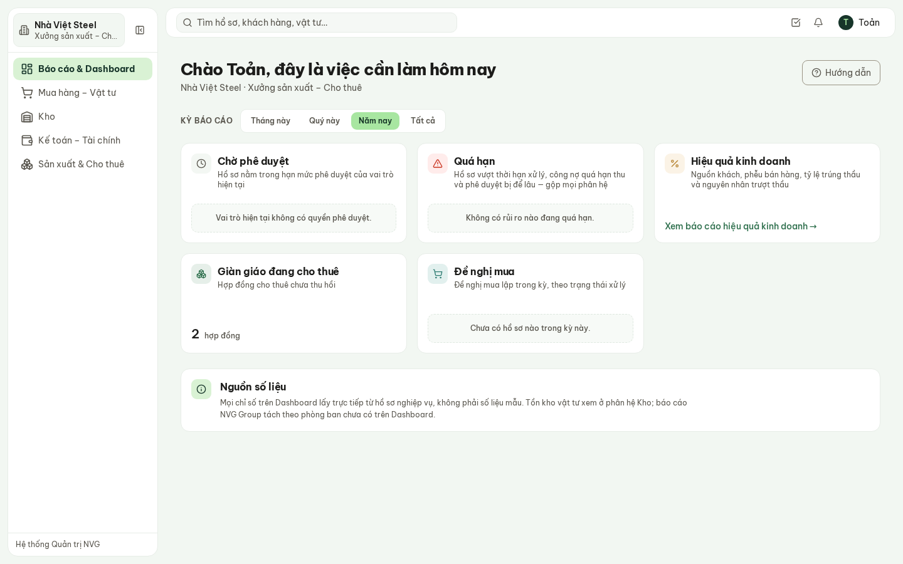
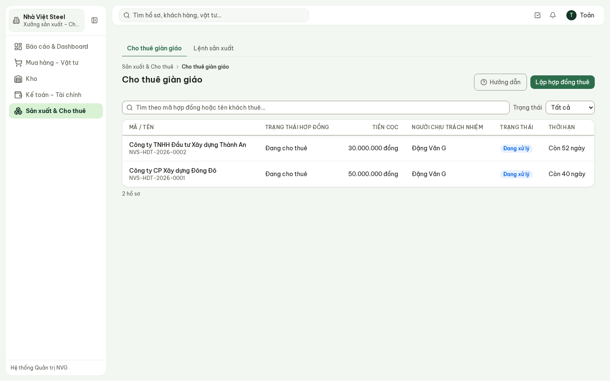
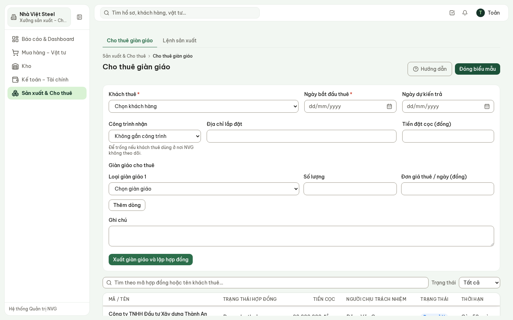
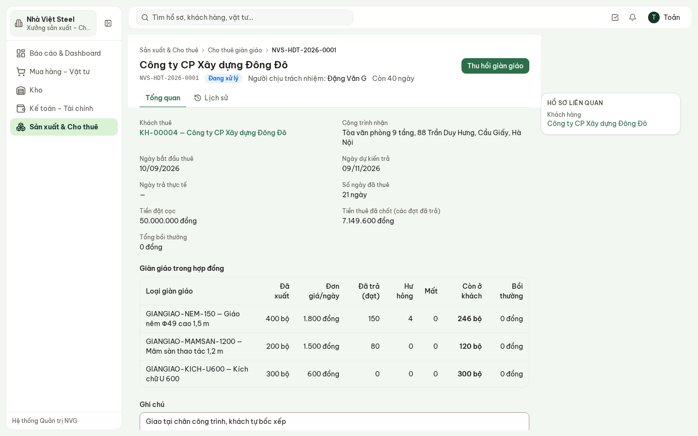
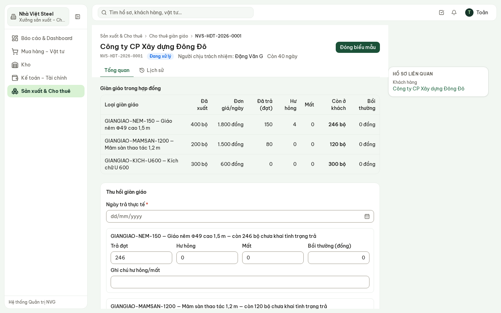
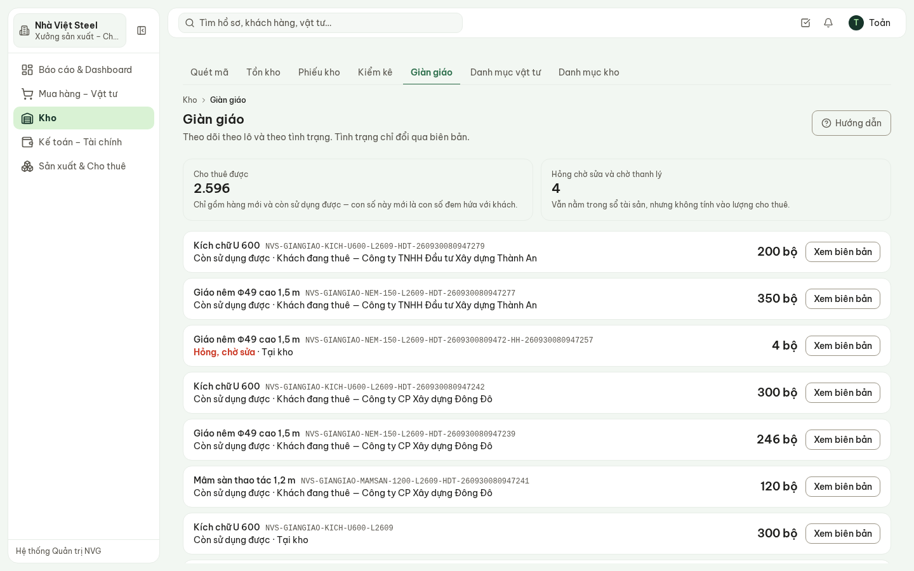
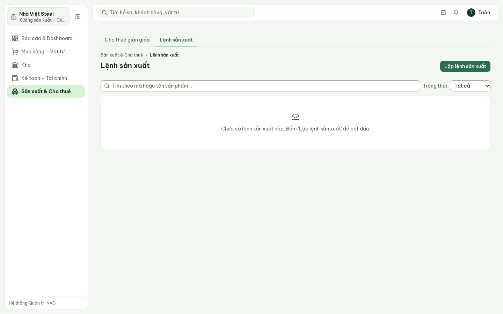

# Hướng dẫn sử dụng — Cho thuê giàn giáo

Hệ thống Phần mềm Quản trị Nhà Việt Group · Xưởng sản xuất – Cho thuê, Nhà Việt Steel

| | |
| --- | --- |
| **Áp dụng cho** | Trưởng xưởng, nhân viên cho thuê (vai trò **Xưởng sản xuất – Cho thuê**) và Kho của Nhà Việt Steel |
| **Thiết bị** | Máy tính; điện thoại dùng được để xem hợp đồng và ghi nhận thu hồi tại bãi |
| **Địa chỉ** | `https://nvg.tests99.workers.dev` |
| **Tài khoản demo** | `sanxuat.nvs@nhavietgroup.test` — mật khẩu nhận riêng từ đầu mối dự án |
| **Phiên bản** | Bản dùng cho buổi trình diễn |

> Hỏi «giàn giáo đang ở đâu, khách nào đang giữ bao nhiêu, trả về bao nhiêu hư hỏng» thì mở hệ thống,
> không lật sổ tay hay Excel. Lập hợp đồng là **xuất giáo khỏi kho ngay trong cùng một lần lưu**; thu
> hồi là **ghi từng đợt trả** — tiền thuê tính theo số ngày thuê thật của đợt đó, không tính tay.

---

## 1. Xưởng làm gì trên hệ thống

| Việc | Màn hình | Khi nào |
| --- | --- | --- |
| Xem số hợp đồng đang cho thuê | **Dashboard** → thẻ Giàn giáo đang cho thuê | Mỗi sáng |
| Lập hợp đồng thuê và xuất giáo | **Sản xuất & Cho thuê** → Cho thuê giàn giáo → **Lập hợp đồng thuê** | Khi giao giáo cho khách |
| Theo dõi một hợp đồng: đã xuất, đã trả, còn ở khách | Chi tiết hợp đồng thuê | Khi khách hỏi, khi đối chiếu |
| Ghi nhận khách trả giáo (đạt, hư hỏng, mất) | Chi tiết hợp đồng → **Thu hồi giàn giáo** | Mỗi đợt khách trả |
| Xem sổ giàn giáo theo lô và tình trạng | **Kho** → Giàn giáo | Khi cần biết còn bao nhiêu cho thuê được |

**Hình 1.** Dashboard của Xưởng Nhà Việt Steel: 2 hợp đồng đang cho thuê.

## 2. Danh sách hợp đồng thuê

**Sản xuất & Cho thuê** → **Cho thuê giàn giáo**.

**Hình 2.** Hai hợp đồng đang cho thuê: Đông Đô và Thành An, tiền cọc, thời hạn.

- Cột **Thời hạn** là **ngày dự kiến trả**. Quá ngày đó mà hợp đồng còn đang cho thuê thì hiện
  **Quá hạn**.
- Trạng thái hợp đồng: **Đang cho thuê** → **Đã thu hồi** (khi mọi loại giáo đã trả hết).

## 3. Lập hợp đồng thuê

**Lập hợp đồng thuê** mở biểu mẫu ngay trên danh sách:

**Hình 3.** Biểu mẫu lập hợp đồng thuê.

1. **Khách thuê** — chọn từ danh mục khách hàng (dùng chung với Kinh doanh, không nhập lại).
2. **Ngày bắt đầu thuê**, **Ngày dự kiến trả**.
3. **Công trình nhận** (để trống nếu khách dùng ở nơi NVG không theo dõi) hoặc **Địa chỉ lắp đặt**.
4. **Tiền đặt cọc**.
5. **Giàn giáo cho thuê** — từng loại: **Loại giàn giáo**, **Số lượng**, **Đơn giá thuê / ngày**.
   **Thêm dòng** cho loại tiếp theo.
6. **Xuất giàn giáo và lập hợp đồng**.

> Bấm lưu là giáo **rời kho ngay**: hệ thống lấy từ các lô **còn dùng được** tại kho và ghi lô đó
> sang «Khách đang thuê». Kho không đủ thì hệ thống báo còn bao nhiêu và không lập hợp đồng — hàng
> hỏng chờ sửa không bao giờ được xuất cho thuê.

## 4. Theo dõi một hợp đồng

Bấm vào hợp đồng để mở chi tiết:

**Hình 4.** Hợp đồng Đông Đô: đã trả một đợt, cột **Còn ở khách** cho biết khách còn giữ bao nhiêu.

- Phần trên: khách thuê, công trình hoặc địa chỉ, ngày bắt đầu, ngày dự kiến trả, **số ngày đã
  thuê**, tiền cọc, **tiền thuê đã chốt** của các đợt đã trả, tổng bồi thường.
- Bảng **Giàn giáo trong hợp đồng**: đã xuất, đơn giá/ngày, đã trả (đạt), hư hỏng, mất, **còn ở
  khách**, bồi thường.
- Tab **Lịch sử**: ai lập, ai thu hồi, lúc nào.

## 5. Thu hồi giàn giáo — từng đợt

Khách trả giáo (một phần hay toàn bộ): **Thu hồi giàn giáo**.

**Hình 5.** Thu hồi: mỗi loại giáo ghi riêng trả đạt, hư hỏng, mất, bồi thường.

1. **Ngày trả thực tế**.
2. Mỗi loại giáo (màn hình ghi sẵn còn bao nhiêu chưa trả): **Trả đạt**, **Hư hỏng**, **Mất**,
   **Bồi thường**, ghi chú hư hỏng/mất. Loại nào đợt này không trả thì để 0.
3. **Xác nhận thu hồi**.

Sau khi lưu:

- **Tiền thuê của đợt** = số lượng trả × đơn giá/ngày × số ngày từ ngày bắt đầu thuê tới ngày trả
  của đợt. Hàng trả sớm không phải trả tiền cho quãng sau khi đã về kho.
- Phần **đạt** về kho, gộp vào lô còn dùng được — cho thuê lại được ngay.
- Phần **hư hỏng** về kho nhưng vào lô **Hỏng, chờ sửa**, kèm biên bản — không tính vào lượng cho
  thuê.
- Phần **mất** không về kho; chỉ còn biên bản để truy trách nhiệm và bồi thường.
- Trả hết mọi loại → hợp đồng chuyển **Đã thu hồi**.

> Không trả được nhiều hơn số còn ở khách, và mỗi dòng trả phải có ít nhất một số lớn hơn 0.

## 6. Sổ giàn giáo theo lô

**Kho** → **Giàn giáo** (vai trò Xưởng chỉ xem; Kho lập biên bản sửa chữa, mất mát, thanh lý — xem
hướng dẫn Kho).

**Hình 6.** Sổ giàn giáo: cho thuê được 2.596, hỏng chờ sửa 4; từng lô đang ở kho hay ở khách nào.

## 7. Lệnh sản xuất

**Sản xuất & Cho thuê** → **Lệnh sản xuất** mới ở mức khung: tên sản phẩm, số lượng, trạng thái.
Định mức tiêu hao, kế hoạch theo tổ, cấp vật tư theo định mức, công đoạn, chất lượng và giá thành
**chưa có** — chờ Xưởng cung cấp bộ định mức và tỷ lệ lỗi thực tế; hệ thống không tự ước lượng các
con số đó.

**Hình 7.** Lệnh sản xuất — bản demo chưa có lệnh nào.

## 8. Phần chưa có trong bản demo

Nói rõ để không ai tưởng đã làm:

- **Tiền thuê vào báo cáo doanh thu khi hợp đồng thu hồi hết**, ghi vào ngày trả cuối. Đợt trả một
  phần đã chốt tiền trên hợp đồng nhưng chưa hiện trên biểu đồ doanh thu của Tổng quan tài chính.
- Giao thêm giáo giữa kỳ vào hợp đồng đang thuê (hiện lập hợp đồng mới).
- Biên bản thu hồi có chữ ký hai bên; đối soát và tất toán chuyển sang Kế toán.
- Giá thuê nội bộ giữa các pháp nhân và loại trừ khỏi báo cáo hợp nhất.
- Xem sổ giàn giáo tại một ngày trong quá khứ.

## 9. Câu hỏi thường gặp

| Câu hỏi | Trả lời |
| --- | --- |
| Không lập được hợp đồng vì «Kho chỉ còn …»? | Lô còn dùng được tại kho không đủ. Hàng hỏng chờ sửa không xuất được; xem Kho → Giàn giáo. |
| Khách trả làm nhiều lần? | Mỗi lần trả là một đợt **Thu hồi giàn giáo**; tiền thuê tính riêng theo ngày trả của từng đợt. |
| Sửa được hợp đồng sau khi lập không? | Không sửa số lượng đã xuất. Xuất thừa thì ghi thu hồi phần thừa (tính tối thiểu 1 ngày thuê). |
| Giáo khách làm hỏng thì sao? | Ghi ở ô **Hư hỏng** kèm bồi thường; giáo về kho vào lô Hỏng, chờ sửa, có biên bản. |
| Vì sao tiền thuê của Đông Đô chưa lên biểu đồ doanh thu? | Hợp đồng chưa thu hồi hết — xem mục 8. |
