# Hướng dẫn sử dụng — Kinh doanh và Dự án – Đấu thầu

Hệ thống Phần mềm Quản trị Nhà Việt Group · từ cơ hội đầu tiên tới hợp đồng và công trình

| | |
| --- | --- |
| **Áp dụng cho** | Nhân viên Kinh doanh (vai trò **Kinh doanh**); Dự toán, Đấu thầu (vai trò **Dự án – Đấu thầu**) |
| **Thiết bị** | Máy tính; điện thoại dùng được để ghi khảo sát tại chỗ khách |
| **Địa chỉ** | `https://nvg.tests99.workers.dev` |
| **Tài khoản demo** | `kinhdoanh.nvc@nhavietgroup.test` (Kinh doanh) · `dauthau.nvc@nhavietgroup.test` (Dự án – Đấu thầu) — mật khẩu nhận riêng |
| **Phiên bản** | Bản dùng cho buổi trình diễn |

> Một cơ hội đi hết vòng mà **không nhập lại**: khách hàng, khảo sát, báo giá đã duyệt → gói thầu,
> khối lượng, dự toán đã duyệt → hợp đồng (lấy sẵn khách hàng và giá) → ngân sách thi công → công
> trình. Mở hợp đồng bất kỳ là truy ngược được về cơ hội gốc.

---

## 1. Ai làm gì

| Việc | Vai trò | Màn hình |
| --- | --- | --- |
| Tiếp nhận khách, theo dõi phễu bán hàng | Kinh doanh | **Khách hàng & Cơ hội** → Cơ hội kinh doanh |
| Khảo sát nhu cầu, lập báo giá, đàm phán | Kinh doanh | Chi tiết cơ hội → Khảo sát, Báo giá |
| Ghi nhận khiếu nại của khách | Kinh doanh | **Khách hàng & Cơ hội** → Khiếu nại |
| Tiếp nhận hồ sơ mời thầu, bóc khối lượng, lập dự toán, nộp thầu | Dự án – Đấu thầu | **Dự án – Đấu thầu** → Gói thầu |
| Lập ngân sách thi công, bàn giao cho công trường | Dự án – Đấu thầu | Chi tiết gói thầu → Ngân sách |
| Soạn, trình duyệt, ghi nhận ký hợp đồng; mở công trình | Kinh doanh, Dự án – Đấu thầu | **Hợp đồng** |
| Điều khoản thanh toán, phát sinh hợp đồng | Dự án – Đấu thầu | Chi tiết hợp đồng → Điều khoản, Phát sinh |

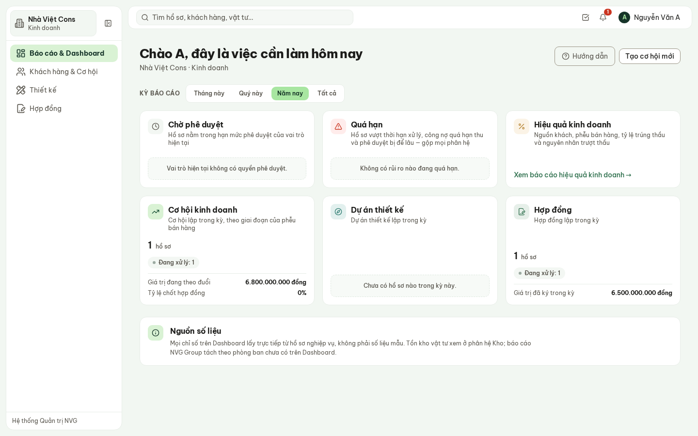

**Hình 1.** Dashboard của Kinh doanh: cơ hội trong kỳ, giá trị đang theo đuổi, tỷ lệ chốt hợp đồng,
hợp đồng đã ký. Nút **Tạo cơ hội mới** ở góc phải.

## 2. Phễu cơ hội

**Khách hàng & Cơ hội** → **Cơ hội kinh doanh**. Mỗi cột là một bước: **Tiếp nhận → Xác minh / Phân
loại → Khảo sát → Báo giá → Đàm phán → Ký hợp đồng**, cộng cột **Mất cơ hội**. Kéo thẻ sang cột
khác để chuyển bước, hoặc bấm **Danh sách** để xem dạng bảng.

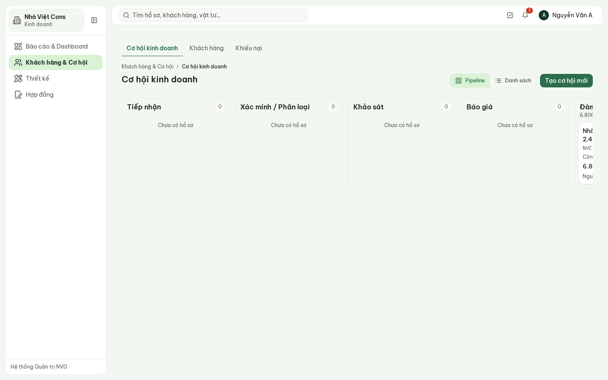

**Hình 2.** Phễu cơ hội — cơ hội nhà xưởng 2.400 m² đang ở bước Đàm phán, 6,8 tỷ.

**Tạo cơ hội mới**: khách hàng (chọn từ danh mục — thêm khách mới ở tab Khách hàng), tên cơ hội,
loại công trình, giá trị dự kiến, tiến độ mong muốn, thời hạn xử lý, ghi chú.

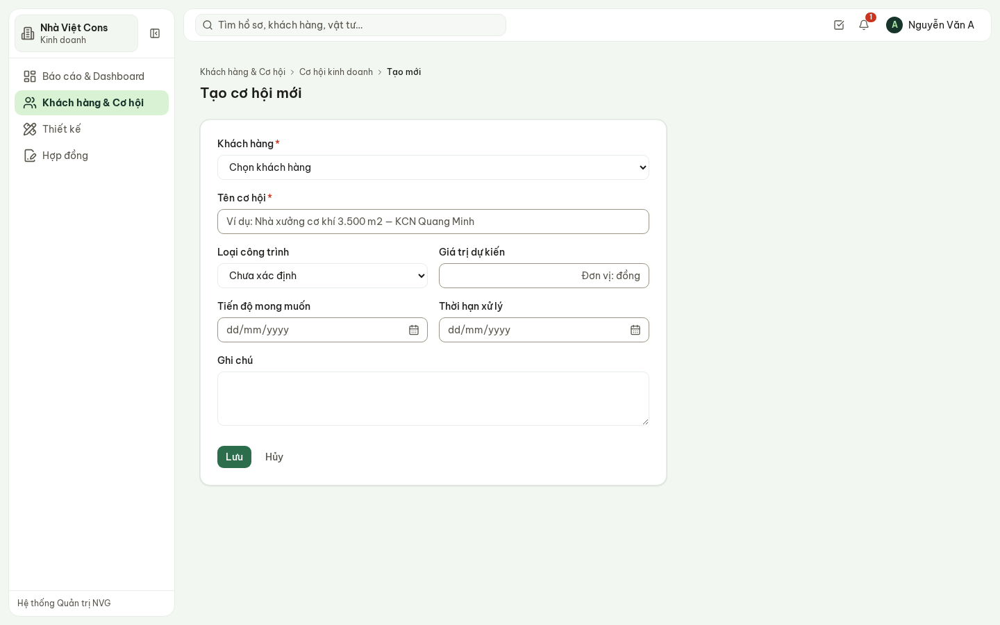

**Hình 3.** Biểu mẫu tạo cơ hội.

> Chuyển sang **Mất cơ hội** bắt buộc ghi nguyên nhân — báo cáo Hiệu quả kinh doanh thống kê nguyên
> nhân mất để rút kinh nghiệm.

## 3. Chi tiết cơ hội: khảo sát, báo giá

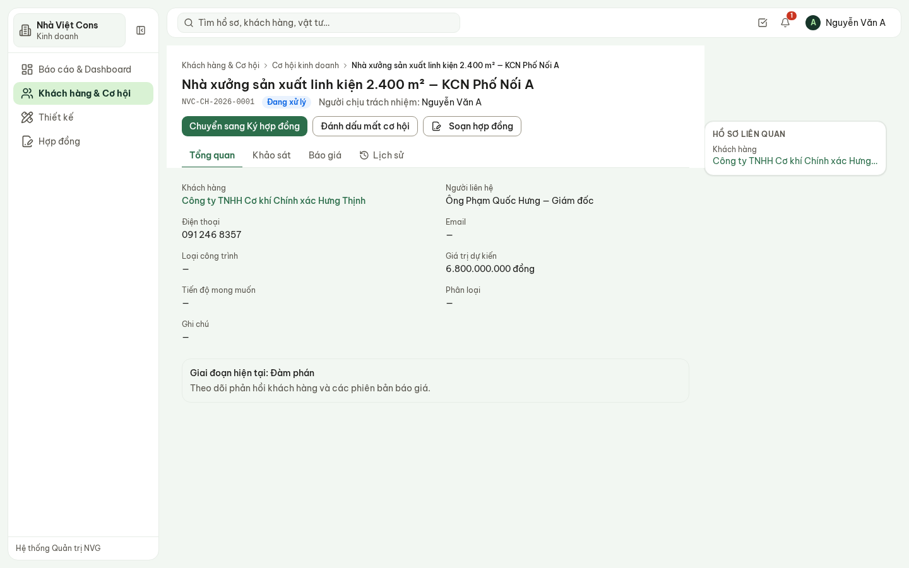

**Hình 4.** Chi tiết cơ hội: nút **Chuyển sang** bước tiếp theo, **Đánh dấu mất cơ hội**, **Soạn hợp đồng**.

- Tab **Khảo sát** → **Đặt lịch khảo sát**; khảo sát xong ghi **biên bản**: nhu cầu, người quyết
  định, ngân sách, tiến độ mong muốn, điều kiện thương mại.
- Tab **Báo giá** → **Lập báo giá** → **Gửi phê duyệt** → sau khi được duyệt mới **Gửi cho khách
  hàng** → **Cập nhật phản hồi** của khách. Báo giá chưa duyệt không gửi khách được.
- Hạn mức duyệt báo giá trong bản demo (mức tạm): tới **500 triệu** — Kinh doanh; lớn hơn — Tổng
  Giám đốc. Báo giá có **chiết khấu đặc biệt** luôn phải Tổng Giám đốc duyệt.

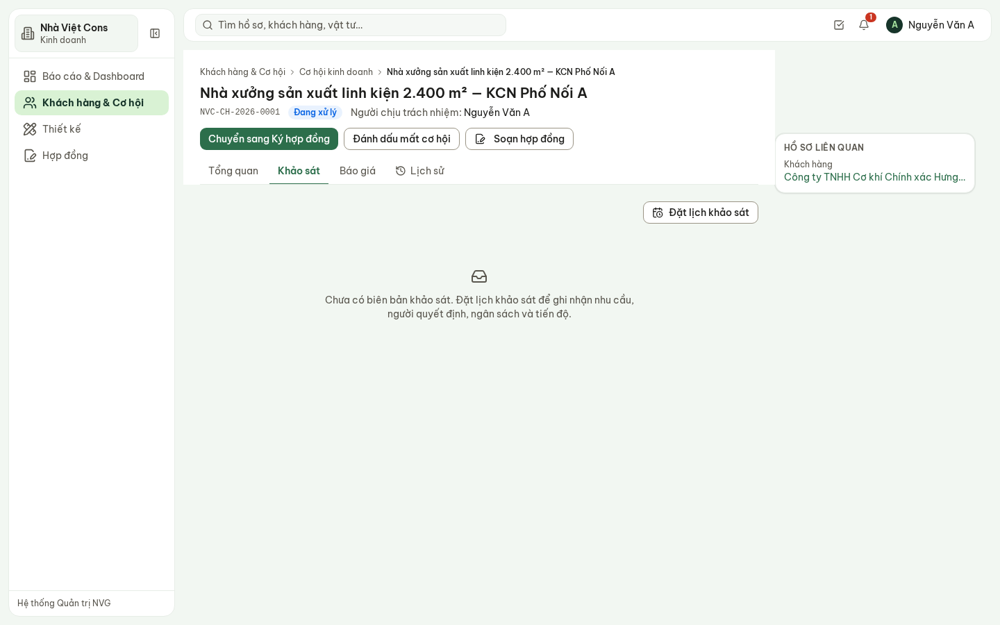

**Hình 5.** Tab Khảo sát.

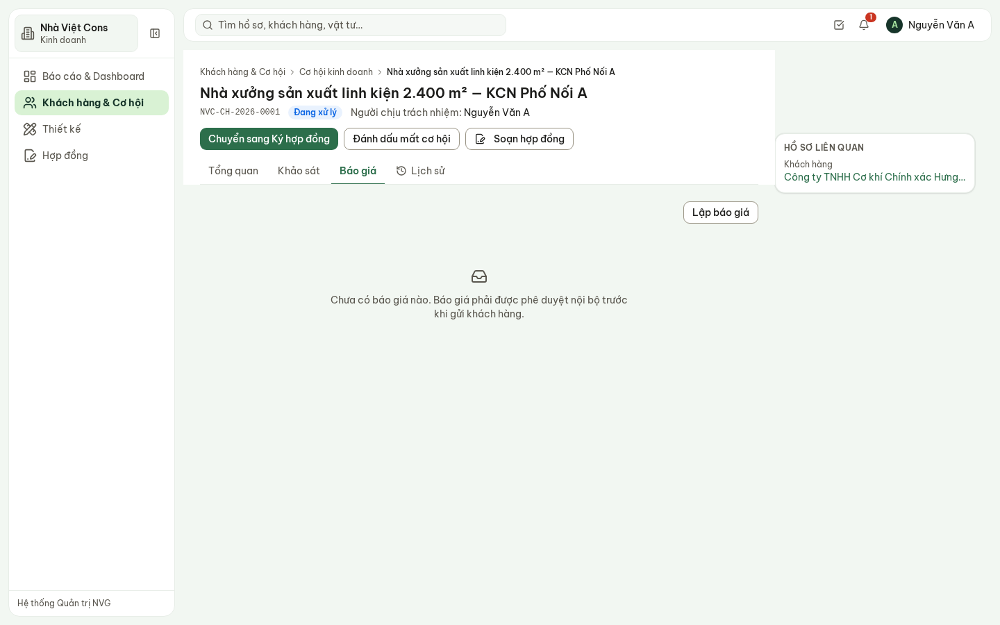

**Hình 6.** Tab Báo giá.

Khách đồng ý (bước **Đàm phán** hoặc **Ký hợp đồng**): bấm **Soạn hợp đồng** ngay trên cơ hội — hợp
đồng lấy sẵn khách hàng, tên và **giá đã duyệt**, không nhập lại (xem mục 7).

## 4. Khách hàng và khiếu nại

**Khách hàng**: danh mục dùng chung cho cả ba pháp nhân — người liên hệ, điện thoại, **nguồn khách**
(giới thiệu, môi giới, website…). Hồ sơ khách hàng có các tab **Cơ hội kinh doanh**, **Khiếu nại**,
**Lịch sử** của khách đó.

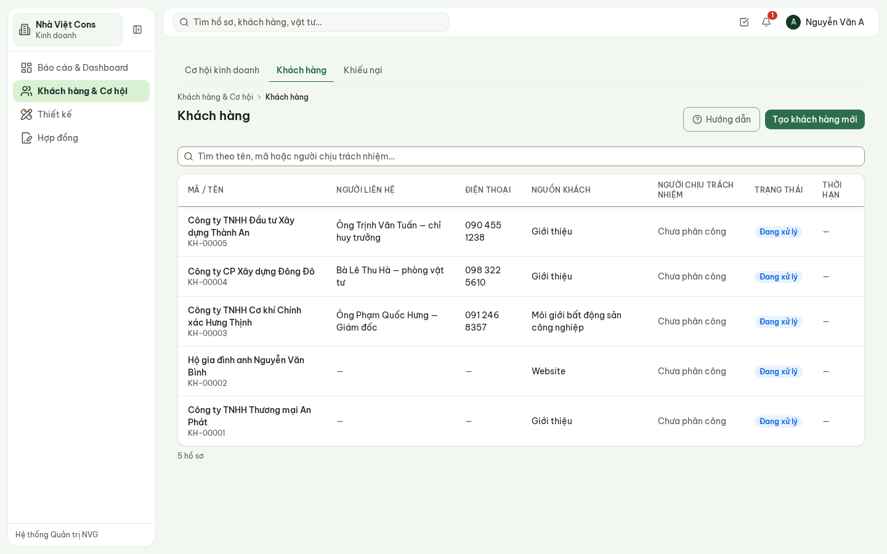

**Hình 7.** Danh mục khách hàng.

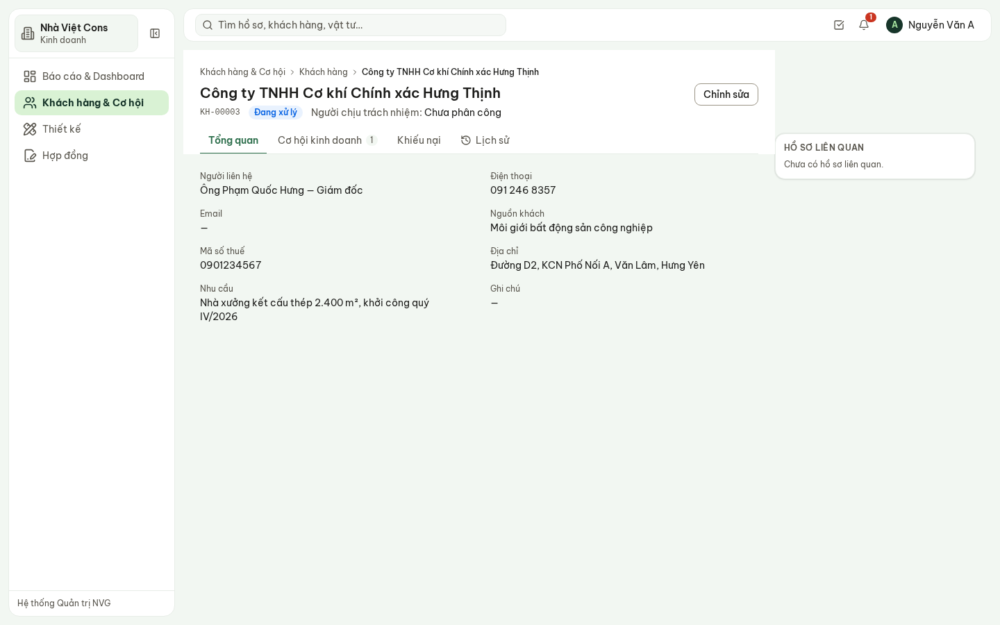

**Hình 8.** Hồ sơ khách hàng Hưng Thịnh.

**Khiếu nại** → **Tạo khiếu nại mới** ngay khi khách phản ánh: ghi đúng lời khách, mức độ, người chủ
trì, thời hạn xử lý. Không thêm nhận xét cảm tính hay suy đoán.

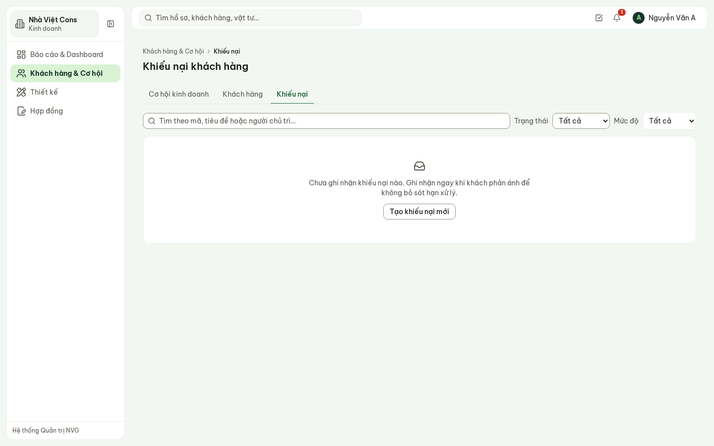

**Hình 9.** Khiếu nại — bản demo chưa có khiếu nại nào.

## 5. Gói thầu (Dự án – Đấu thầu)

**Dự án – Đấu thầu** → **Gói thầu**. Các bước: **Tiếp nhận hồ sơ → Khảo sát hiện trạng → Bóc tách
khối lượng → Lập dự toán → Chờ duyệt giá → Đã duyệt giá → Đã nộp thầu → Trúng thầu / Trượt thầu**.

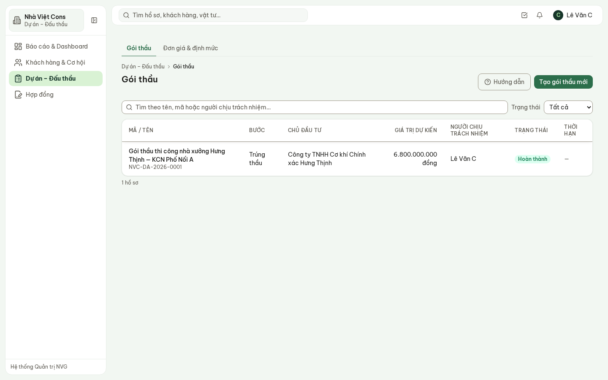

**Hình 10.** Danh sách gói thầu.

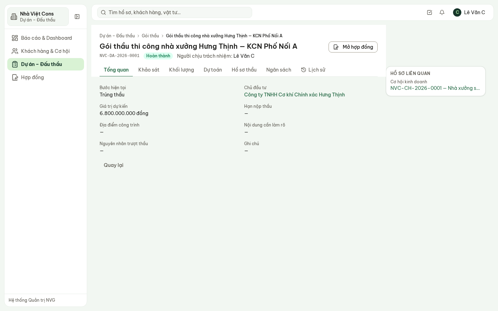

**Hình 11.** Gói thầu Hưng Thịnh đã trúng thầu — nút **Mở hợp đồng** dẫn tới hợp đồng đã soạn.

Các tab của gói thầu:

- **Khảo sát** — hiện trạng, biện pháp, rủi ro.
- **Khối lượng** — hạng mục, đơn vị, khối lượng bóc tách.
- **Dự toán** — từng phiên bản: **giá dự thầu**, căn cứ lập giá, người lập, người duyệt. **Cấu thành
  giá vốn** là dữ liệu nhạy cảm: bấm **Xem cấu thành giá vốn**, mỗi lượt xem được ghi nhật ký.
  Hạn mức duyệt giá (mức tạm): tới **500 triệu** — Dự án – Đấu thầu; lớn hơn — Tổng Giám đốc.
- **Hồ sơ thầu** — danh mục tài liệu nộp thầu; nộp xong hồ sơ chuyển sang chỉ xem.
- **Ngân sách** — xem mục 6.

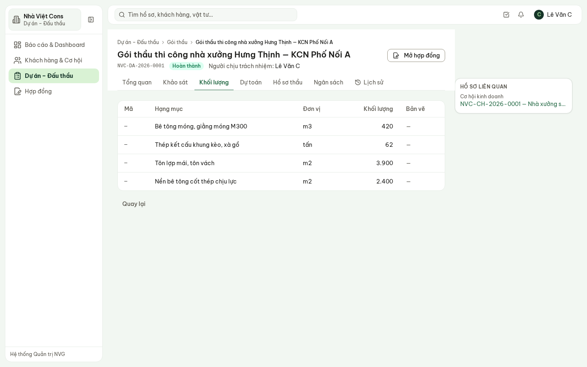

**Hình 12.** Khối lượng bóc tách.

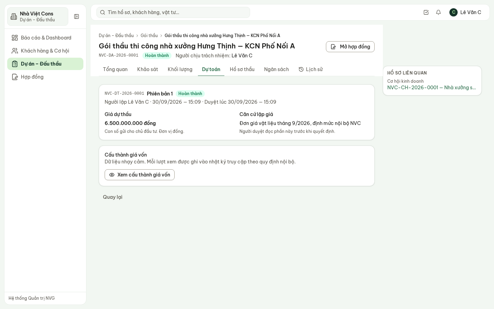

**Hình 13.** Dự toán phiên bản 1 — giá dự thầu 6,5 tỷ, đã duyệt.

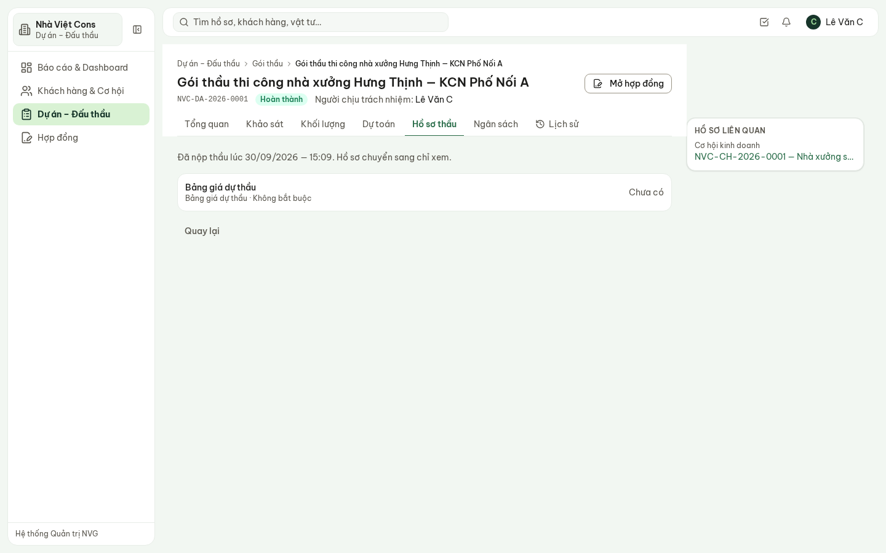

**Hình 14.** Hồ sơ thầu — đã nộp, chuyển sang chỉ xem.

Kết quả: **Ghi nhận trúng thầu** hoặc **Ghi nhận trượt thầu** (bắt buộc ghi nguyên nhân).

## 6. Ngân sách thi công — bàn giao sang công trường

Tab **Ngân sách**: lập từ dự toán đã duyệt, theo mã chi phí (vật tư, nhân công, máy móc, chi phí
chung, dự phòng). Đây là bộ số công trường, Mua hàng và Kế toán dùng chung — cột **Đã cam kết** và
**Đã phát sinh** tự cập nhật khi đặt hàng, nhận hàng, chi tiền.

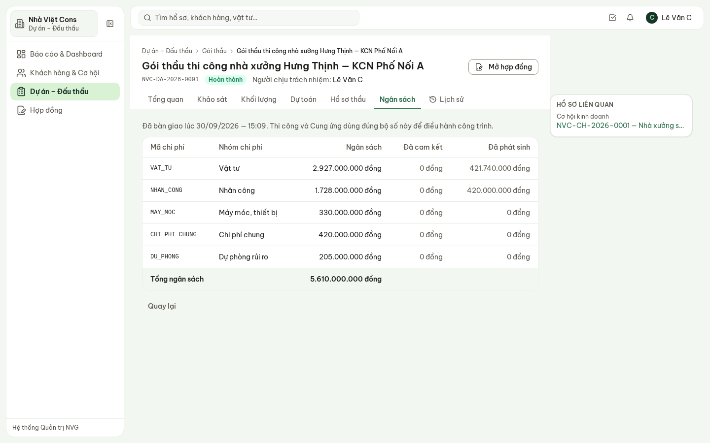

**Hình 15.** Ngân sách thi công Hưng Thịnh: 5,61 tỷ; vật tư đã phát sinh 421,7 triệu, nhân công 420 triệu.

Dòng **Lợi nhuận mục tiêu** chỉ hiện với vai trò được xem lợi nhuận.

**Đơn giá & định mức**: bảng đơn giá dùng chung cho Đấu thầu, Thiết kế và Mua hàng — dữ liệu giá
vốn, mọi lượt xem được ghi nhật ký. Bản demo chưa nạp bảng đơn giá.

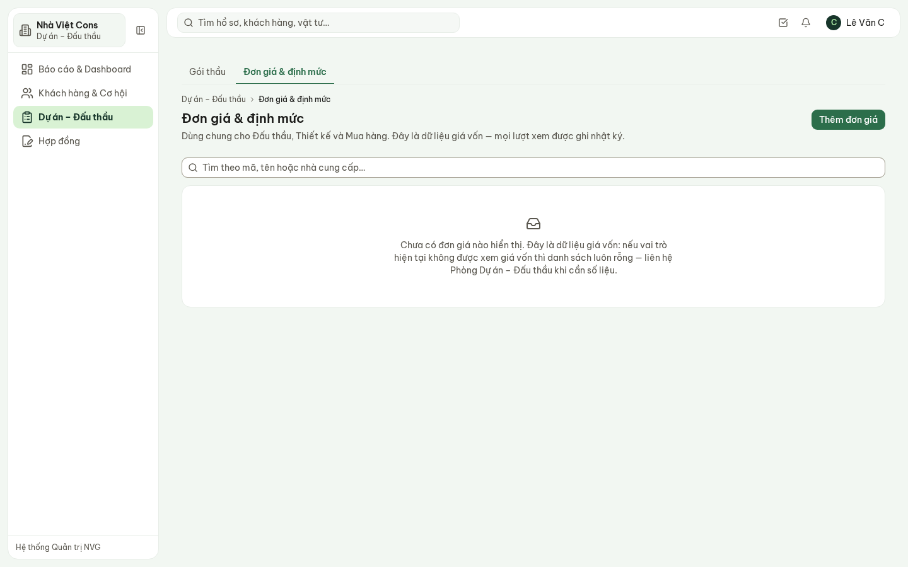

**Hình 16.** Đơn giá & định mức.

## 7. Hợp đồng

**Hợp đồng** không có nút tạo trắng: hợp đồng luôn soạn từ hồ sơ nguồn — **Soạn hợp đồng** trên cơ
hội (bước Đàm phán / Ký hợp đồng) hoặc trên gói thầu đã trúng. Khách hàng, tên và giá đã duyệt lấy
từ hồ sơ nguồn.

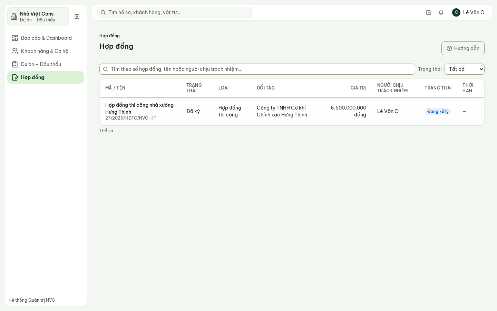

**Hình 17.** Danh sách hợp đồng.

Các bước: **Nháp → Chờ phê duyệt → Đã phê duyệt → Đã ký → Đã quyết toán** (hoặc Đã hủy).

1. **Gửi phê duyệt** — hạn mức (mức tạm): tới **200 triệu** — Dự án – Đấu thầu; lớn hơn — Tổng Giám đốc.
2. **Ghi nhận đã ký** — nhập **số hợp đồng** theo văn bản và **ngày ký**.
3. **Mở công trình** — tạo công trình thi công từ hợp đồng; ngân sách đã duyệt đi theo công trình.
   Mỗi hợp đồng chỉ mở một công trình; đã mở thì nút không còn.
4. **Quyết toán hợp đồng** khi hoàn tất.

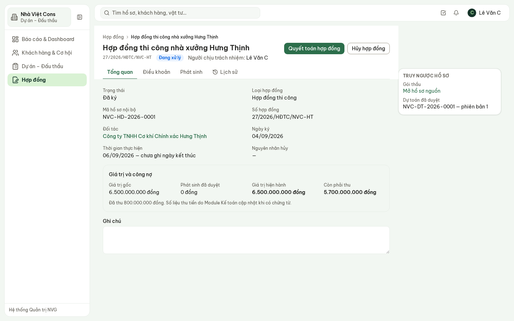

**Hình 18.** Hợp đồng Hưng Thịnh: giá trị gốc 6,5 tỷ, đã thu 800 triệu, còn phải thu 5,7 tỷ; bên
phải truy ngược về gói thầu và dự toán đã duyệt.

- Tab **Điều khoản** — phạm vi công việc, giá trị, tiến độ thanh toán, tạm ứng, bảo hành… Mỗi
  điều khoản ghi **ngày đến hạn** để hệ thống nhắc khoản sắp đến hạn; **Đánh dấu đã hoàn thành**
  khi xong.
- Tab **Phát sinh** — **Đề xuất phát sinh** cho mọi việc ngoài phạm vi. Mỗi lúc chỉ hiện một nút
  cho bước tiếp theo: **Đã gửi báo giá cho khách hàng** → **Gửi phê duyệt** (hạn mức tạm: tới 50
  triệu — Trưởng phòng Thi công; lớn hơn — Tổng Giám đốc) → **Ghi nhận khách hàng xác nhận** →
  **Ghi nhận đã thực hiện**. Việc khẩn cấp (an toàn, tránh thiệt hại lớn hơn) được làm trước nhưng
  phải ghi người có thẩm quyền đã cho phép. Chỉ phát sinh **đã phê duyệt** mới cộng vào giá trị
  hiện hành của hợp đồng.

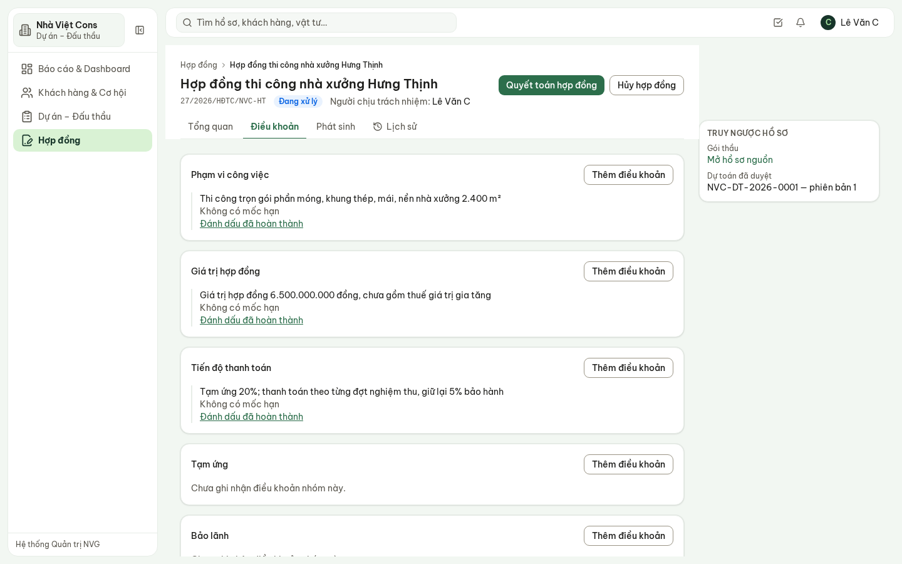

**Hình 19.** Điều khoản hợp đồng.

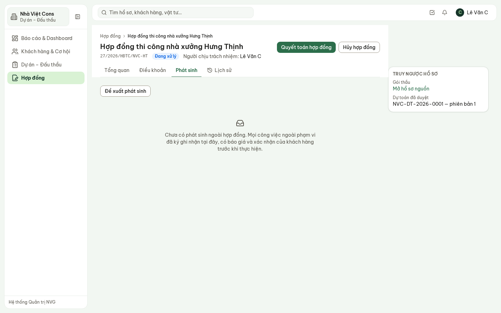

**Hình 20.** Phát sinh hợp đồng.

## 8. Câu hỏi thường gặp

| Câu hỏi | Trả lời |
| --- | --- |
| Không gửi báo giá cho khách được? | Báo giá chưa được phê duyệt. Gửi phê duyệt trước; chờ người có hạn mức duyệt. |
| Muốn tạo hợp đồng từ danh sách Hợp đồng? | Không có nút đó. Soạn từ cơ hội (Đàm phán / Ký hợp đồng) hoặc gói thầu đã trúng. |
| Không thấy nút **Mở công trình**? | Hợp đồng chưa ký, là hợp đồng khoán tổ đội, hoặc đã có công trình. |
| Kinh doanh có thấy giá vốn không? | Không. Cấu thành giá vốn và đơn giá chỉ hiện với vai trò được phép, mỗi lượt xem được ghi lại. |
| Cơ hội đã ký hợp đồng còn sửa được không? | Sau khi bàn giao, cơ hội chuyển sang chỉ xem; thay đổi tiếp theo làm trên hợp đồng. |
