# Hướng dẫn sử dụng — Hành chính – Nhân sự

Hệ thống Phần mềm Quản trị Nhà Việt Group · hồ sơ, hợp đồng, chấm công, giấy tờ, tài sản, nghỉ phép, tuyển dụng

| | |
| --- | --- |
| **Áp dụng cho** | Trưởng phòng và nhân viên Hành chính – Nhân sự (vai trò **Hành chính – Nhân sự**), phục vụ cả ba pháp nhân |
| **Thiết bị** | Máy tính |
| **Địa chỉ** | `https://nvg.tests99.workers.dev` |
| **Tài khoản demo** | `nhansu@nhavietgroup.test` — mật khẩu nhận riêng từ đầu mối dự án |
| **Phiên bản** | Bản dùng cho buổi trình diễn |

> Mỗi người có **một hồ sơ duy nhất** từ lúc nhận việc tới lúc bàn giao: hợp đồng, giấy tờ, tài sản
> đang giữ, ngày công, đơn nghỉ đều gắn vào hồ sơ đó. Hệ thống **nhắc trước** việc phải làm (giấy tờ
> sắp hết hạn, thử việc sắp hết, kỳ công chờ chốt), **không tự quyết** việc nhân sự: đánh giá thử
> việc, chọn ứng viên, kỷ luật là quyết định của người có thẩm quyền.

---

## 1. Hành chính – Nhân sự làm gì trên hệ thống

| Việc | Màn hình | Khi nào |
| --- | --- | --- |
| Xem việc phải xử lý trong ngày | **Việc cần xử lý** | Mỗi sáng |
| Mở kỳ, ghi công, xác nhận, chốt và chuyển Kế toán | **Chấm công** | Hằng ngày / đầu tháng |
| Lập, sửa hồ sơ; chuyển chính thức; hợp đồng lao động | **Hồ sơ nhân sự** | Khi có người mới, khi đổi thông tin |
| Theo dõi chứng chỉ, giấy khám sức khỏe, giấy phép lái xe | **Giấy tờ** | Khi có nhắc hạn |
| Cấp phát, thu hồi, sửa chữa tài sản | **Tài sản** | Khi giao, khi nhận lại |
| Lập đơn nghỉ, duyệt đơn | **Nghỉ phép**, **Việc cần làm** | Khi có đơn |
| Yêu cầu tuyển dụng, theo dõi ứng viên | **Tuyển dụng** | Khi bộ phận cần người |

Ô chọn ở góc trên bên trái đổi pháp nhân. Kỳ chấm công, hồ sơ, tài sản thuộc về **một** pháp nhân.

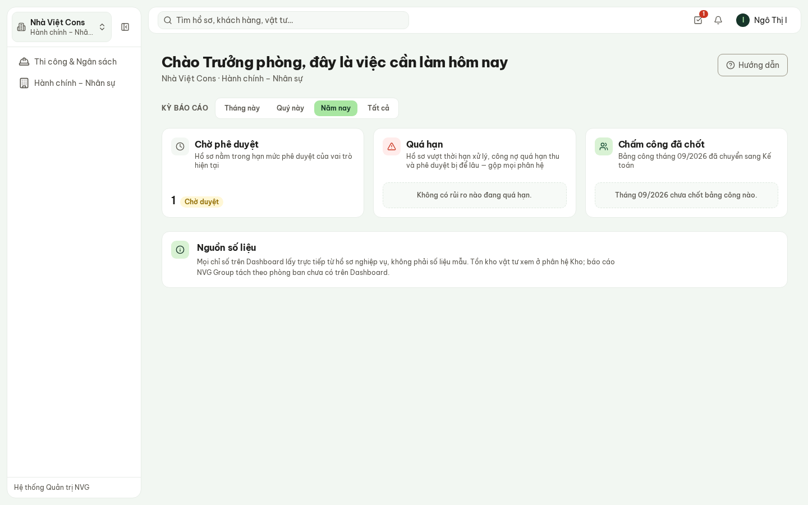

**Hình 1.** Trang đầu của Trưởng phòng HCNS: một hồ sơ chờ duyệt; bảng công tháng 9 chưa chốt.

## 2. Việc cần xử lý

**Hành chính – Nhân sự** → **Việc cần xử lý** chỉ chứa thứ có việc phải làm. Bấm tên thẻ để mở
đúng màn hình xử lý.

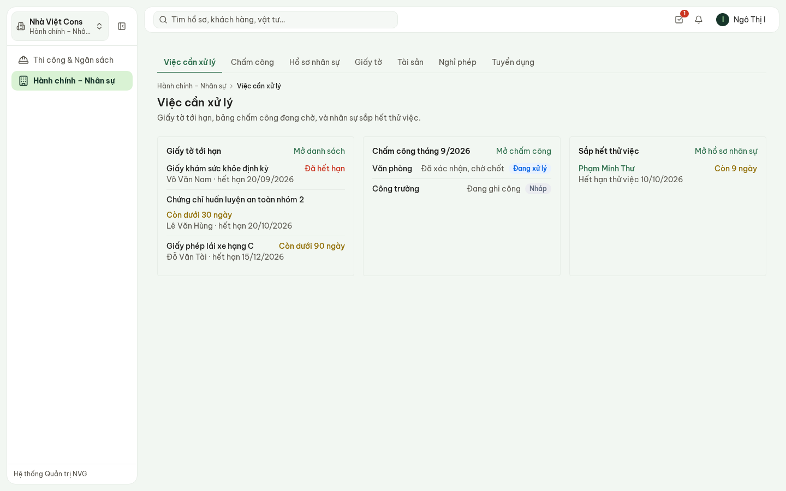

**Hình 2.** Giấy khám sức khỏe đã hết hạn, chứng chỉ an toàn còn dưới 30 ngày; công văn phòng đã
xác nhận, công trường đang ghi; một người còn 9 ngày hết thử việc.

- **Giấy tờ tới hạn**: đã hết hạn, còn dưới 30 ngày, còn dưới 90 ngày.
- **Chấm công tháng trước**: trạng thái từng khối.
- **Sắp hết thử việc**: nhắc đánh giá **trước** ngày hết hạn.

## 3. Chấm công ba khối

**Chấm công**: kỳ mặc định là **tháng trước** — đầu tháng là lúc chốt công tháng vừa qua.

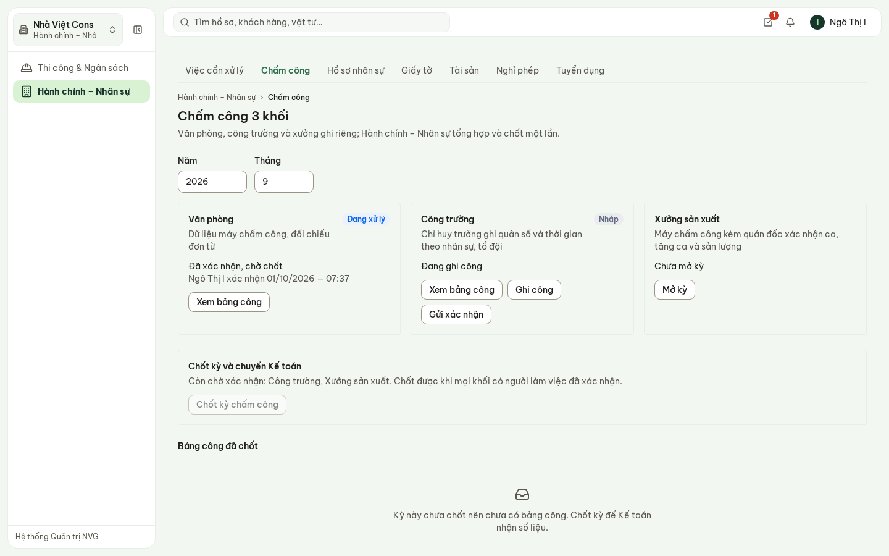

**Hình 3.** Tháng 9: văn phòng đã xác nhận, công trường đang ghi, xưởng chưa mở kỳ — nút chốt còn
khoá và màn hình nói rõ còn thiếu khối nào.

Ba khối ghi và xác nhận khác nhau:

| Khối | Ai ghi công | Ai xác nhận |
| --- | --- | --- |
| Văn phòng | Hành chính – Nhân sự | Trưởng phòng Hành chính – Nhân sự |
| Công trường | Chỉ huy trưởng, Thi công (Hành chính – Nhân sự ghi hộ được) | Trưởng phòng Thi công |
| Xưởng sản xuất | Xưởng sản xuất (Hành chính – Nhân sự ghi hộ được) | Ban Giám đốc |

Trình tự mỗi khối:

1. **Mở kỳ**.
2. **Ghi công** — chọn ngày và số giờ, hệ thống ghi cho **cả khối** ngày đó (đúng cách công
   trường điểm danh quân số hằng ngày).
3. **Xem bảng công** để sửa riêng từng người (mục 3.1).
4. **Gửi xác nhận** → trưởng đơn vị **Xác nhận số liệu**. Đã gửi xác nhận thì bảng công khoá.
5. Khi mọi khối có người làm việc đã xác nhận: **Chốt kỳ chấm công**. Số liệu chuyển sang Kế toán;
   sau khi chốt, muốn điều chỉnh phải nêu lý do.

> Khối không có ai làm việc và không mở kỳ thì không cần xác nhận — Nhà Việt One không có xưởng
> vẫn chốt công bình thường.

### 3.1. Bảng công từng người

**Xem bảng công** trên thẻ một khối mở bảng người × ngày của tháng.

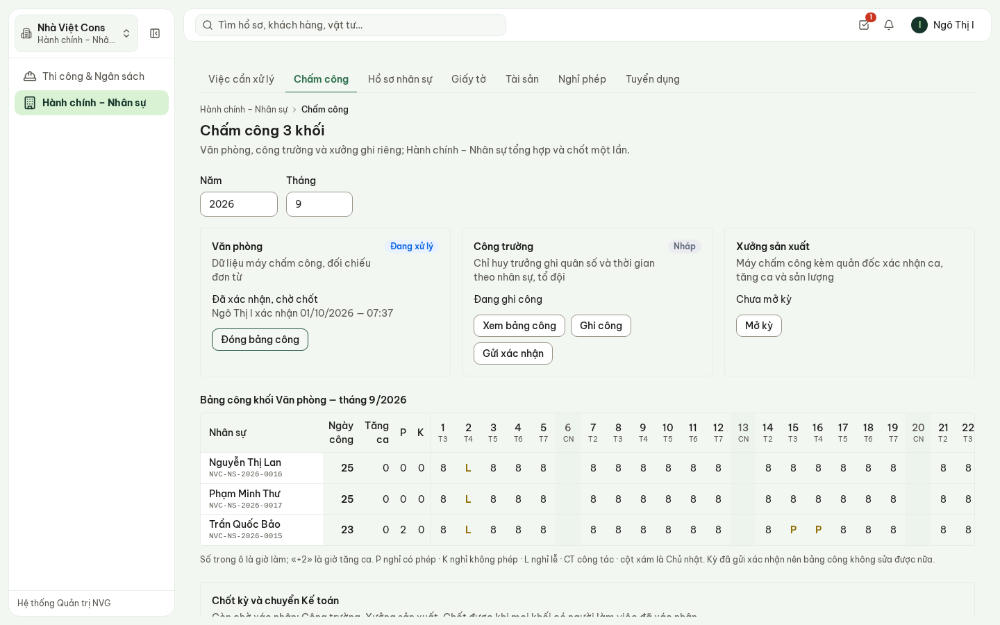

**Hình 4.** Bảng công văn phòng tháng 9: 02/09 nghỉ lễ (L), Trần Quốc Bảo nghỉ phép 15–16/09 (P).

- Số trong ô là giờ làm; «+2» là giờ tăng ca. **P** nghỉ có phép · **K** nghỉ không phép ·
  **L** nghỉ lễ · **CT** công tác. Cột xám là Chủ nhật.
- Cột **Ngày công**, **Tăng ca**, **P**, **K** đứng ngay sau tên — quy giờ ra ngày công theo
  8 giờ/ngày.
- Kỳ còn **Đang ghi**: bấm một ô để sửa ngày công của người đó.

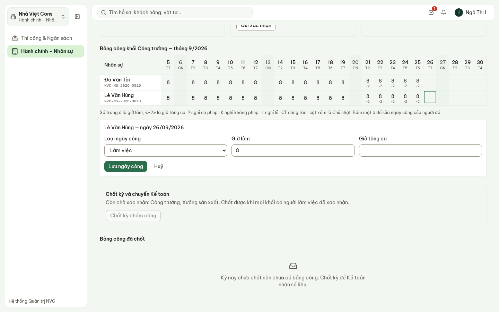

**Hình 5.** Sửa ngày 26/09 của Lê Văn Hùng: loại ngày công, giờ làm, giờ tăng ca.

> **Nghỉ có phép** chỉ ghi được khi người đó có **đơn nghỉ phép đã duyệt** cho ngày đó. Không có
> đơn thì hệ thống từ chối và nói rõ: lập đơn trước, hoặc ghi nghỉ không phép.

## 4. Hồ sơ nhân sự

**Hồ sơ nhân sự**: tìm theo tên, mã hoặc chức danh; lọc theo trạng thái. Mỗi người một mã
`NVC-NS-2026-…` do hệ thống cấp.

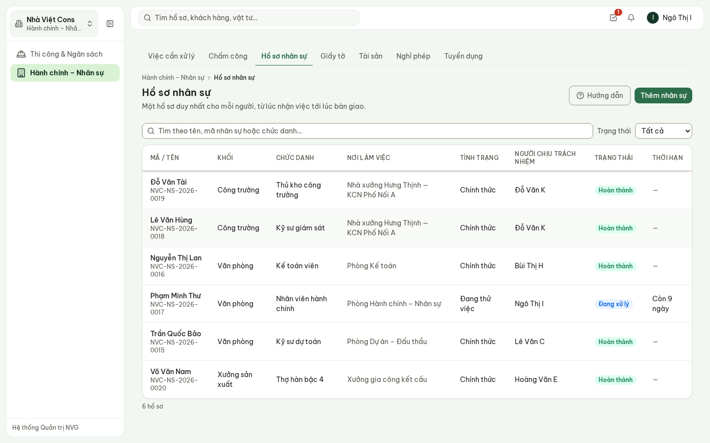

**Hình 6.** Sáu nhân sự Nhà Việt Cons ở ba khối; người thử việc hiện số ngày còn lại.

Danh sách **không có cột lương**. Bấm một người để mở hồ sơ:

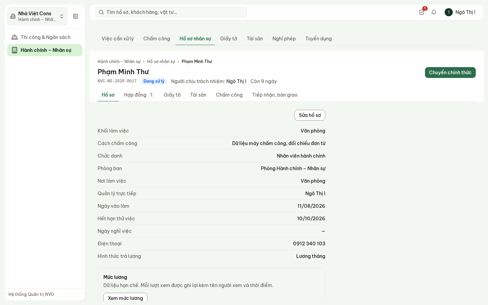

**Hình 7.** Hồ sơ Phạm Minh Thư — đang thử việc, còn 9 ngày.

- Tab: **Hồ sơ** · **Hợp đồng** · **Giấy tờ** · **Tài sản** · **Chấm công** (bảng công đã chốt,
  đơn nghỉ) · **Tiếp nhận, bàn giao**.
- **Xem mức lương**: lương không hiện sẵn; mỗi lần bấm xem được ghi lại tên người xem và thời
  điểm. Nút chỉ hiện với Ban Giám đốc, Giám đốc Tài chính, Hành chính – Nhân sự và Kế toán.
- **Sửa hồ sơ**: chức danh, phòng ban, điện thoại, thư điện tử, quản lý trực tiếp, tình trạng
  (thử việc · chính thức · tạm nghỉ), ngày hết thử việc.

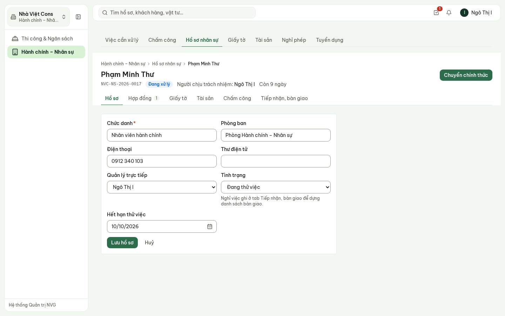

**Hình 8.** Sửa hồ sơ. Lương, căn cước và khối làm việc không sửa ở đây.

### 4.1. Chuyển chính thức

Người đang thử việc có nút **Chuyển chính thức** ở góc trên. Xác nhận xong, tình trạng đổi thành
**Chính thức** và hệ thống mở sẵn biểu mẫu **hợp đồng chính thức** ở tab Hợp đồng. Kết quả đánh
giá thử việc là quyết định của trưởng bộ phận — phần mềm chỉ ghi lại.

## 5. Hợp đồng lao động

Tab **Hợp đồng** → **Thêm hợp đồng**:

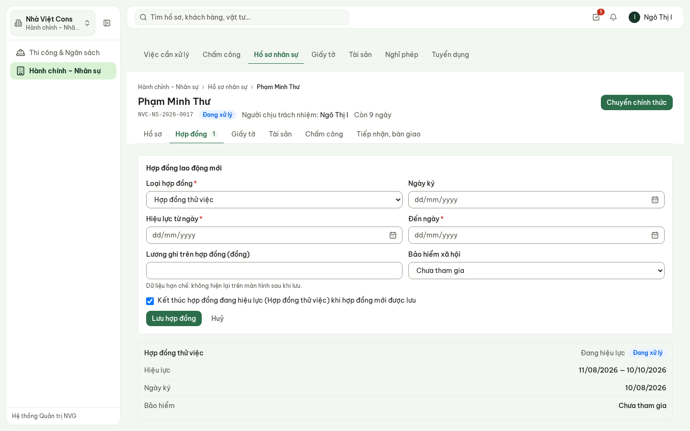

**Hình 9.** Lập hợp đồng: loại, ngày ký, hiệu lực, lương trên hợp đồng, bảo hiểm.

1. **Loại hợp đồng**: thử việc · xác định thời hạn · không xác định thời hạn · khoán việc, thời vụ.
2. **Hiệu lực từ ngày**, **Đến ngày** (hợp đồng không xác định thời hạn không có ngày kết thúc).
3. **Lương ghi trên hợp đồng** — dữ liệu hạn chế, không hiện lại sau khi lưu.
4. **Bảo hiểm xã hội**: chưa tham gia · đang tham gia (kèm số sổ) · đã báo giảm.
5. **Kết thúc hợp đồng đang hiệu lực** — bật sẵn khi người đó đang có hợp đồng: lưu hợp đồng mới
   thì hợp đồng cũ (ví dụ thử việc) chuyển **Đã kết thúc**, không còn hai hợp đồng cùng hiệu lực.

## 6. Tiếp nhận và nghỉ việc

Tab **Tiếp nhận, bàn giao**:

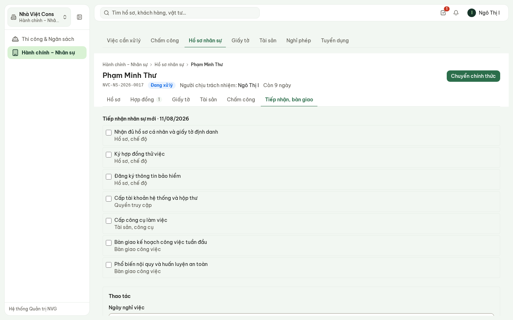

**Hình 10.** Danh sách tiếp nhận: hồ sơ, hợp đồng, bảo hiểm, tài khoản, công cụ, kế hoạch tuần
đầu, nội quy an toàn.

- **Lập checklist tiếp nhận** cho người mới; đánh dấu từng việc khi xong (ghi tên người làm).
- **Ghi nhận nghỉ việc**: chọn ngày nghỉ; hệ thống dựng **danh sách bàn giao** theo đúng tài sản
  người đó đang giữ.

## 7. Thêm nhân sự

**Hồ sơ nhân sự** → **Thêm nhân sự**:

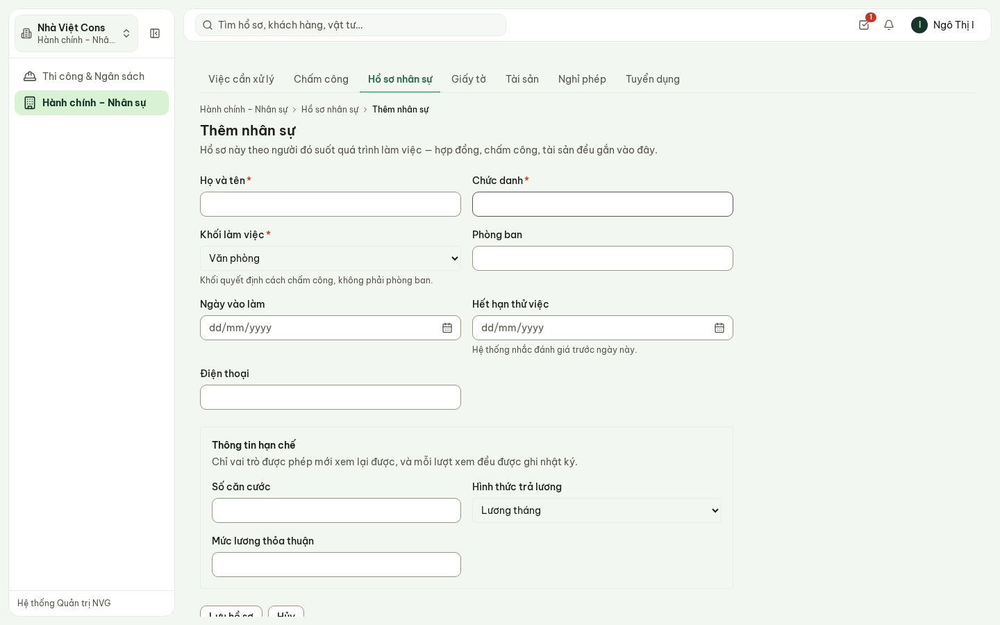

**Hình 11.** Biểu mẫu một trang: họ tên, chức danh, khối, phòng ban, ngày vào làm, hết hạn thử
việc, điện thoại; phần hạn chế gồm căn cước, hình thức trả lương, mức lương.

- **Khối làm việc** quyết định cách chấm công (văn phòng, công trường, xưởng), không phải phòng ban.
- Lưu xong hệ thống cấp mã và mở hồ sơ vừa tạo. Người nhận việc từ **Tuyển dụng** thì hồ sơ tự
  sinh, không nhập lại.

## 8. Giấy tờ có thời hạn

**Giấy tờ**: chứng chỉ hành nghề, chứng chỉ an toàn, giấy phép lái xe, giấy khám sức khỏe, bảo
hiểm… Hạn gần nhất đứng đầu.

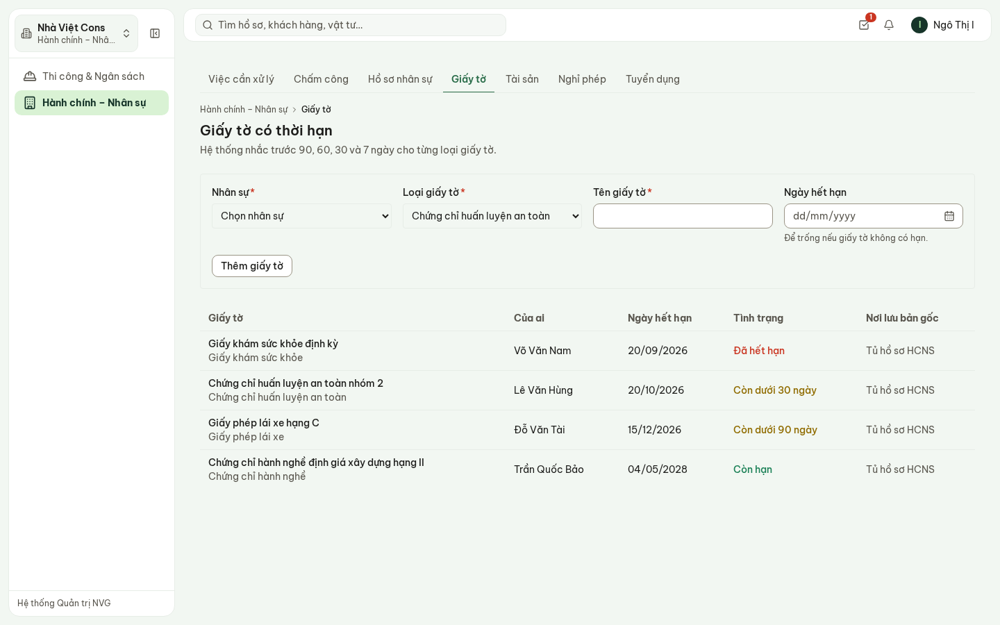

**Hình 12.** Giấy khám sức khỏe đã hết hạn; chứng chỉ an toàn còn dưới 30 ngày.

- Hệ thống **tự nhắc trước 90, 60, 30 và 7 ngày**, mỗi mốc một lần.
- Tình trạng ghi bằng chữ: **Đã hết hạn**, **Còn dưới 30 ngày**, **Còn dưới 90 ngày**, **Còn hạn**.
- Ghi **nơi lưu bản gốc** để biết bản giấy nằm ở tủ nào.

## 9. Tài sản cấp phát

**Tài sản**: ai đang giữ, tình trạng ra sao.

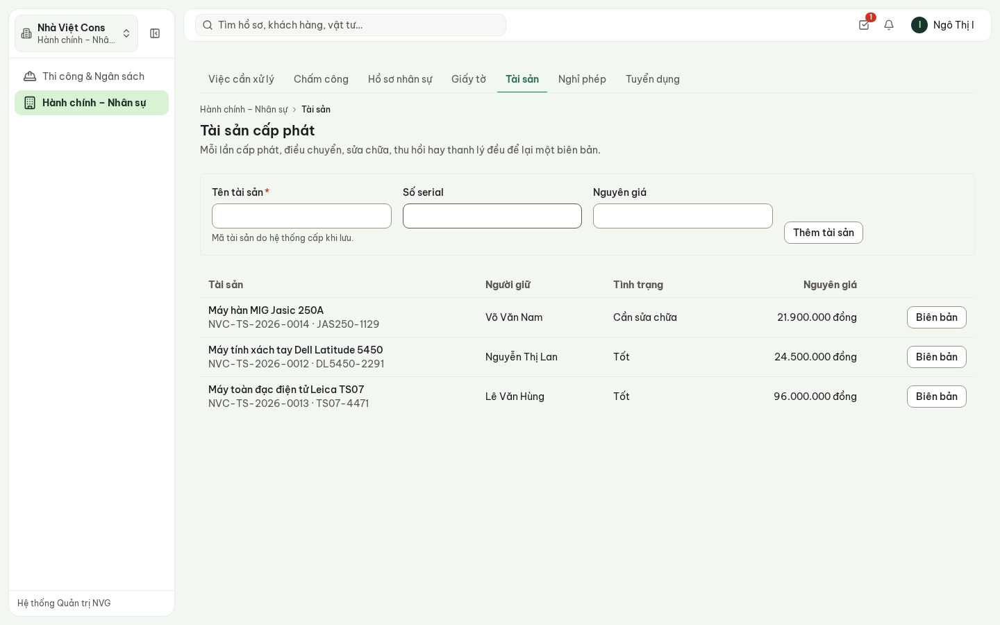

**Hình 13.** Ba tài sản đang cấp phát; máy hàn cần sửa chữa.

- **Thêm tài sản**: tên, số serial, nguyên giá — mã do hệ thống cấp.
- Người giữ và tình trạng **chỉ đổi qua biên bản**: **Biên bản** → cấp phát · điều chuyển · sửa
  chữa · thu hồi · thanh lý. Mỗi lần đổi tay để lại một biên bản đọc được về sau.

## 10. Nghỉ phép

**Nghỉ phép**: lập đơn cho nhân sự (nhân sự, loại nghỉ, từ ngày, đến ngày, lý do) → **Gửi phê
duyệt**.

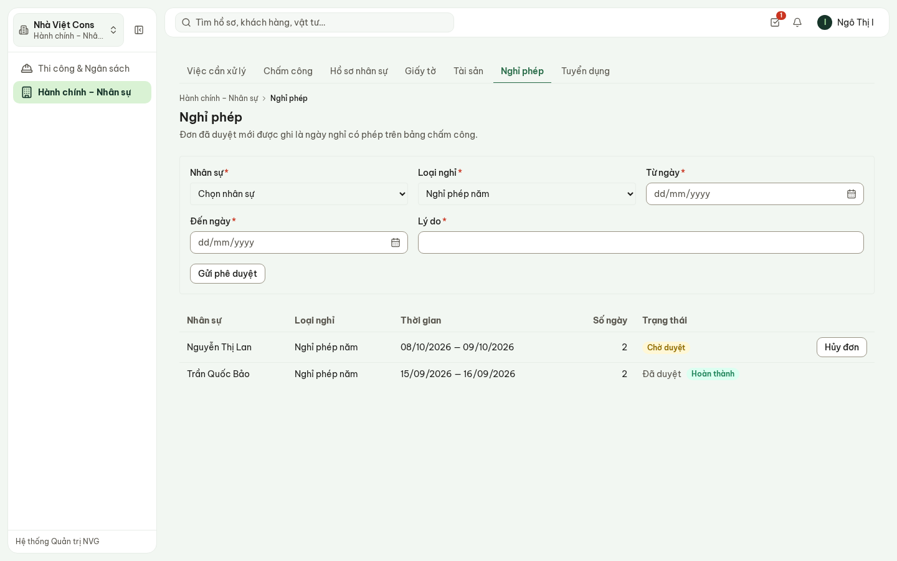

**Hình 14.** Một đơn chờ duyệt (Nguyễn Thị Lan 08–09/10), một đơn đã duyệt (Trần Quốc Bảo
15–16/09).

Đơn **không duyệt ở màn hình này**: nó vào **Việc cần làm** (biểu tượng ô vuông có dấu tích, góc
trên) như mọi hồ sơ cần duyệt khác. Trưởng phòng Hành chính – Nhân sự duyệt đơn nghỉ.

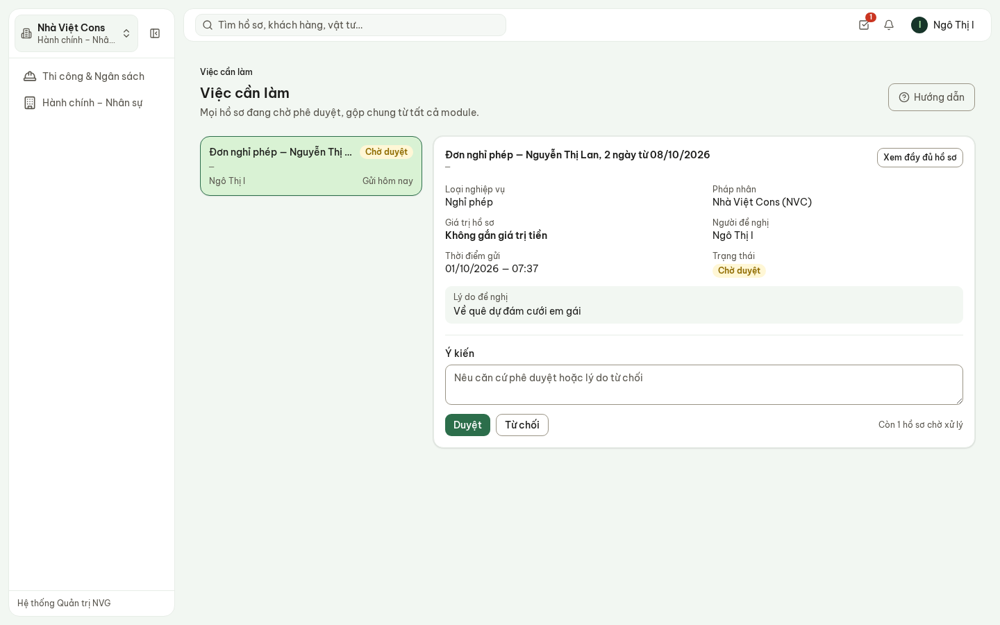

**Hình 15.** Đơn nghỉ trong hộp thư phê duyệt: **Duyệt** hoặc **Từ chối** (từ chối phải nêu lý do).

- Đơn trùng ngày với đơn khác đang chờ hoặc đã duyệt thì không gửi được.
- Đơn đã duyệt mới được ghi thành **nghỉ có phép** trên bảng công.

## 11. Tuyển dụng

**Tuyển dụng**: yêu cầu tuyển (vị trí, khối, số lượng, yêu cầu chuyên môn) → **Gửi phê duyệt**.
Được duyệt thì vị trí chuyển **Đang tuyển**; bấm **Ứng viên** để mở bảng ứng viên.

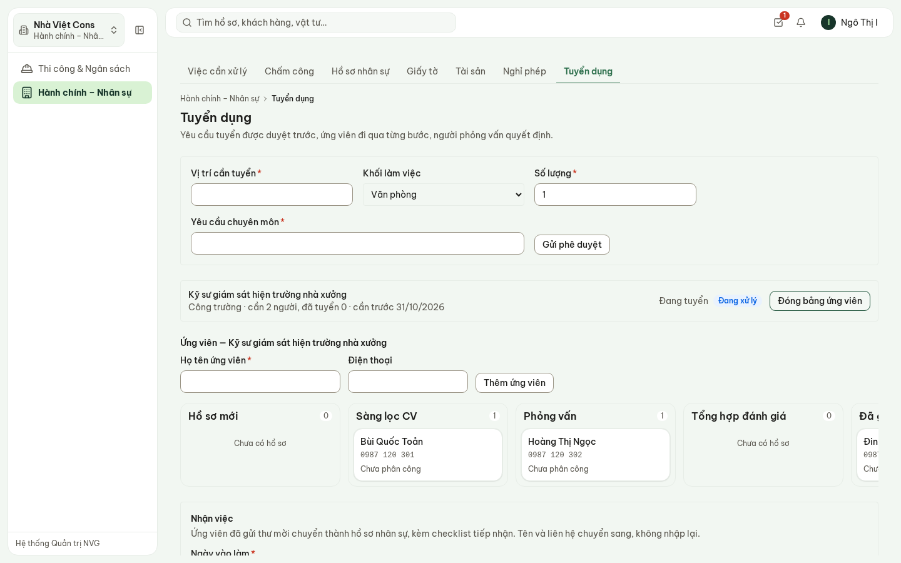

**Hình 16.** Vị trí kỹ sư giám sát hiện trường: ứng viên ở các bước sàng lọc, phỏng vấn, mời nhận
việc.

- Các bước: hồ sơ mới → sàng lọc CV → phỏng vấn → tổng hợp đánh giá → đã gửi thư mời → nhận việc.
- **Nhận việc**: ứng viên đã nhận thư mời thành hồ sơ nhân sự kèm checklist tiếp nhận — tên và
  liên hệ chuyển sang, không nhập lại.
- Phần mềm **không chấm điểm, không xếp hạng, không gợi ý chọn ai** — người phỏng vấn quyết định,
  hệ thống ghi lại.

## 12. Phần chưa có trong bản demo

Nói rõ để không ai tưởng đã làm:

- Thưởng – phạt theo kỳ công (CSDL đã có, chưa có màn hình).
- Lao động thời vụ của tổ đội trên màn hình Nhân sự.
- Điều chỉnh bảng công **sau khi chốt** (phải nêu lý do và người duyệt) — chưa có màn hình.
- Trả một khối đã gửi xác nhận về «Đang ghi» để sửa tiếp.
- Tính lương từ ngày công — quy chế lương NVG chưa ban hành; hệ thống dừng ở bảng công đã chốt.
- Nối máy chấm công vân tay / khuôn mặt — hiện ghi công trên hệ thống.

## 13. Câu hỏi thường gặp

| Câu hỏi | Trả lời |
| --- | --- |
| Không chốt được kỳ chấm công? | Còn khối có người làm việc chưa xác nhận — màn hình ghi rõ khối nào. |
| Ghi «nghỉ có phép» bị từ chối? | Người đó chưa có đơn nghỉ đã duyệt cho ngày đó. Lập đơn ở **Nghỉ phép**, chờ duyệt, rồi ghi lại. |
| Muốn sửa công sau khi đã gửi xác nhận? | Bảng công khoá khi đã gửi. Bản demo chưa có thao tác trả về «Đang ghi». |
| Không thấy lương trên hồ sơ? | Lương không hiện sẵn. Bấm **Xem mức lương** — mỗi lượt xem được ghi lại. |
| Thử việc xong thì làm gì? | Hồ sơ → **Chuyển chính thức** → lập hợp đồng chính thức; hợp đồng thử việc tự kết thúc. |
| Đổi người giữ tài sản thế nào? | **Tài sản** → **Biên bản** → điều chuyển. Không sửa thẳng ô người giữ. |
| Phần mềm có chọn ứng viên giúp không? | Không. Người phỏng vấn quyết định; hệ thống chỉ ghi lại từng bước. |
