# Hướng dẫn sử dụng — Trưởng phòng Thi công

Hệ thống Phần mềm Quản trị Nhà Việt Group · công trình, ngân sách, phân công, đề nghị, nghiệm thu, chấm công công trường

| | |
| --- | --- |
| **Áp dụng cho** | Trưởng phòng Thi công (vai trò **Trưởng phòng Thi công**) — quản lý nhiều công trình của Nhà Việt Cons, Nhà Việt One |
| **Thiết bị** | Máy tính; điện thoại để xem nhanh công trình |
| **Địa chỉ** | `https://nvg.tests99.workers.dev` |
| **Tài khoản demo** | `congtruong.nvc@nhavietgroup.test` — mật khẩu nhận riêng từ đầu mối dự án |
| **Phiên bản** | Bản dùng cho buổi trình diễn |

> Chỉ huy trưởng ghi việc ở hiện trường (xem hướng dẫn Chỉ huy trưởng). Trưởng phòng Thi công nhìn
> **nhiều công trình cùng lúc**: tiến độ, ngân sách còn bao nhiêu, đề nghị nào đang kẹt ở đâu, ai
> được giao công trình nào, và xác nhận công của khối công trường. Mọi con số chi phí cập nhật tự
> động từ chứng từ Mua hàng, Kho, Kế toán — không nhập tay.

---

## 1. Trưởng phòng Thi công làm gì trên hệ thống

| Việc | Màn hình | Khi nào |
| --- | --- | --- |
| Xem công trình đang thi công, công trình vượt ngân sách | **Dashboard** | Mỗi sáng |
| Theo dõi từng công trình: tiến độ, nhật ký, ngân sách, nghiệm thu | **Thi công & Ngân sách** → **Công trình** | Hằng ngày |
| Chuyển bước công trình, tạm dừng | Chi tiết công trình | Khi công trình đổi giai đoạn |
| Xem mọi đề nghị từ công trường, nhắc người đang giữ | **Theo dõi đề nghị** | Hằng ngày |
| Giao chỉ huy trưởng, giám sát vào công trình | **Phân công** | Khi mở công trình, khi đổi người |
| Ghi, xem và xác nhận công khối công trường | **Chấm công công trường** | Hằng ngày / đầu tháng |
| Duyệt phát sinh hợp đồng trong hạn mức | **Việc cần làm** | Khi có hồ sơ |

Thanh dưới tiêu đề của phân hệ có bốn mục: **Công trình** · **Theo dõi đề nghị** · **Phân công** ·
**Chấm công công trường**.

## 2. Dashboard

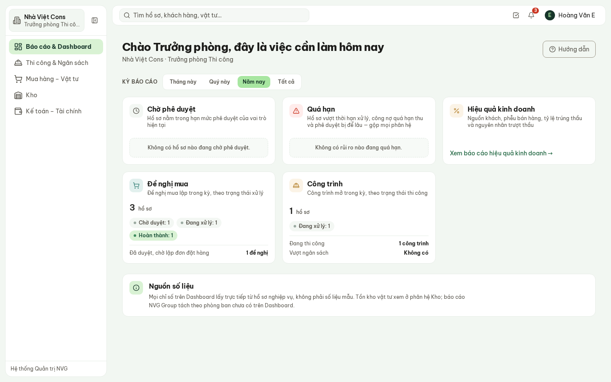

**Hình 1.** Dashboard của Trưởng phòng Thi công: thẻ Công trình (1 đang thi công, không có công
trình vượt ngân sách) và thẻ Đề nghị mua.

- **Công trình**: số công trình theo trạng thái; **Đang thi công**; **Vượt ngân sách**. Bấm con số
  để mở danh sách đã lọc.
- **Đề nghị mua**: đề nghị vật tư từ các công trình theo trạng thái xử lý.
- **Chờ phê duyệt**: hồ sơ trong hạn mức của Trưởng phòng Thi công (phát sinh hợp đồng tới 50 triệu,
  mức tạm).

## 3. Danh sách công trình

**Thi công & Ngân sách** → **Công trình**: mã, tên, bước, địa điểm, tiến độ, **ngân sách** (trong
ngân sách / sắp vượt / vượt), chỉ huy trưởng chịu trách nhiệm, thời hạn. Lọc theo trạng thái và theo
ngân sách.

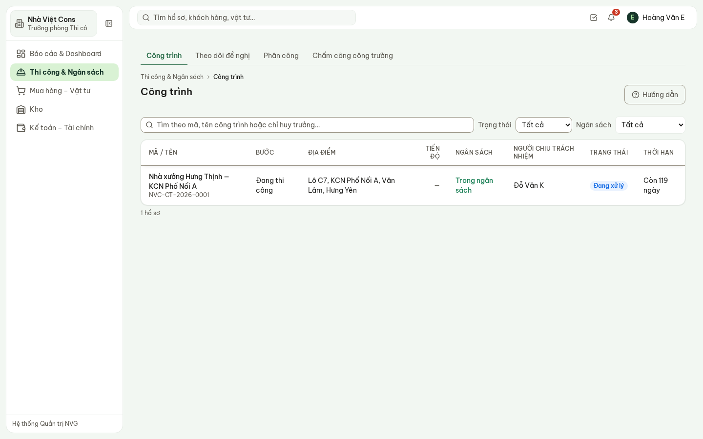

**Hình 2.** Công trình Nhà xưởng Hưng Thịnh đang thi công, trong ngân sách, còn 119 ngày.

## 4. Chi tiết công trình

Bấm tên công trình để mở hồ sơ. Các tab: **Nhật ký** · **Điểm danh** · **Hồ sơ – Bản vẽ** ·
**Ngân sách** · **Đề nghị** · **Nghiệm thu** · **Tổ đội** · **Bảo hành** · **Tổng quan** · **Lịch sử**.

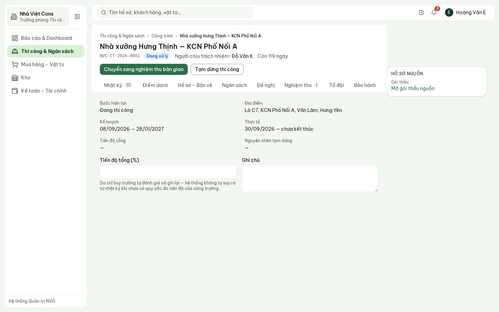

**Hình 3.** Tổng quan: bước hiện tại, địa điểm, kế hoạch và thực tế, tiến độ tổng.

- Nút chính đi theo bước của công trình: **Bắt đầu thi công** → **Chuyển sang nghiệm thu bàn
  giao** → **Bàn giao chủ đầu tư** → **Kết thúc công trình**.
- **Tạm dừng thi công** bắt buộc ghi nguyên nhân.
- **Tiến độ tổng (%)** do chỉ huy trưởng tự đánh giá — hệ thống không tự suy ra từ nhật ký.
- Panel bên phải dẫn về **gói thầu nguồn** của công trình.

### 4.1. Ngân sách

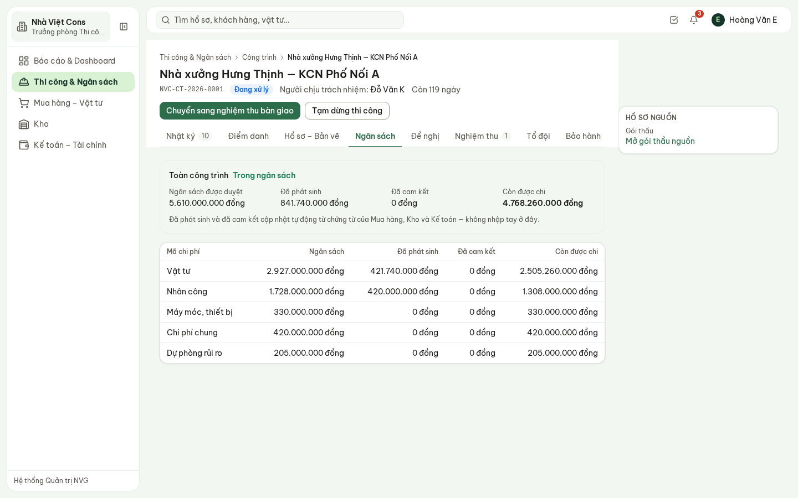

**Hình 4.** Ngân sách 5,61 tỷ; đã phát sinh 841,7 triệu; còn được chi 4,77 tỷ; từng mã chi phí.

- **Ngân sách được duyệt** lấy từ dự toán đã phê duyệt ở gói thầu — không nhập lại.
- **Đã phát sinh** (đã nhận hàng, đã chi) và **Đã cam kết** (đã đặt hàng, chưa nhận) cập nhật tự
  động từ Mua hàng, Kho, Kế toán.
- Mã chi phí sắp vượt hoặc đã vượt hiện cảnh báo bằng chữ và biểu tượng, không chỉ bằng màu.

### 4.2. Đề nghị của công trình

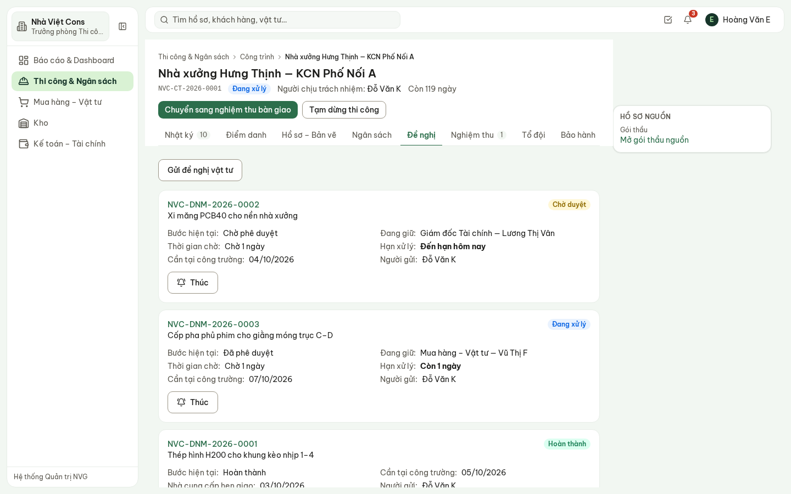

**Hình 5.** Ba đề nghị vật tư: bước hiện tại, ai đang giữ, đã chờ bao lâu, hạn xử lý.

Mỗi đề nghị cho biết **đang giữ ở ai**. Chậm thì bấm **Thúc** — lời nhắc được ghi vào lịch sử của
đề nghị. Đề nghị vật tư do Mua hàng và Giám đốc Tài chính duyệt theo hạn mức; Trưởng phòng Thi
công theo dõi và nhắc.

### 4.3. Nhật ký và điểm danh

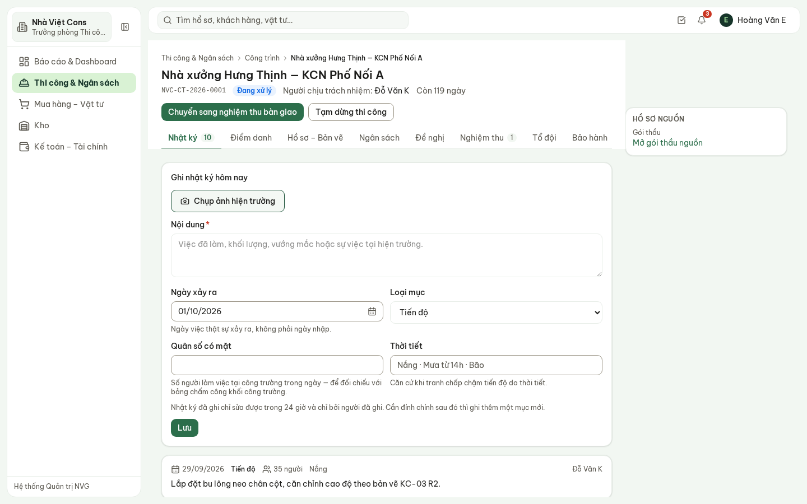

**Hình 6.** Nhật ký công trình: nội dung, ngày, loại mục, quân số, thời tiết, ảnh hiện trường.

Trưởng phòng đọc nhật ký và ảnh của mọi công trình trong ngày; ghi thêm được khi cần. Nhật ký chỉ
sửa được trong 24 giờ và bởi chính người ghi — sai thì ghi thêm một mục đính chính.

### 4.4. Nghiệm thu

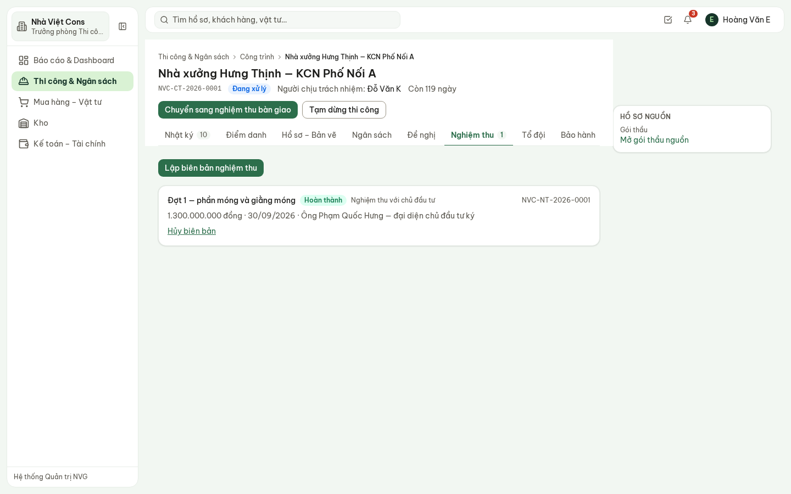

**Hình 7.** Đợt 1 — phần móng và giằng móng: nghiệm thu với chủ đầu tư, 1,3 tỷ, ngày 30/09/2026.

**Lập biên bản nghiệm thu**: loại nghiệm thu (với chủ đầu tư hoặc với tổ đội), giai đoạn / hạng
mục, giá trị, ngày, **người ký phía đối tác**, danh mục kiểm tra. Biên bản đã ký **không sửa được**;
sai thì **Hủy biên bản** (nêu lý do) rồi lập lại. Doanh thu thực tế trên báo cáo lãi/lỗ ghi theo giá
trị đã nghiệm thu với chủ đầu tư.

### 4.5. Tổ đội và bảo hành

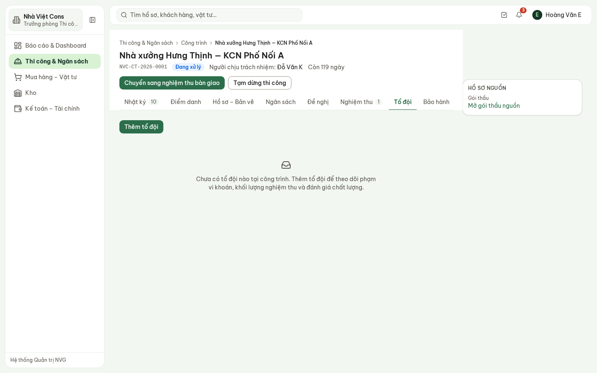

**Hình 8.** Tổ đội của công trình — chưa có tổ đội nào trong bản demo.

- **Thêm tổ đội**: tên tổ đội / nhà thầu phụ, hình thức giao việc, phạm vi công việc, giá trị giao
  khoán, người liên hệ tại hiện trường, thời gian. Sau đó ghi **khối lượng nghiệm thu** và **đánh giá
  chất lượng** của tổ đội.
- **Bảo hành**: thời hạn bảo hành, phản ánh của khách hàng, người nội bộ chịu trách nhiệm, trạng thái
  xử lý.

## 5. Theo dõi đề nghị — mọi công trường

**Theo dõi đề nghị** mở sẵn **Tất cả công trình**: mọi đề nghị từ các công trường, ai đang giữ,
chờ bao lâu.

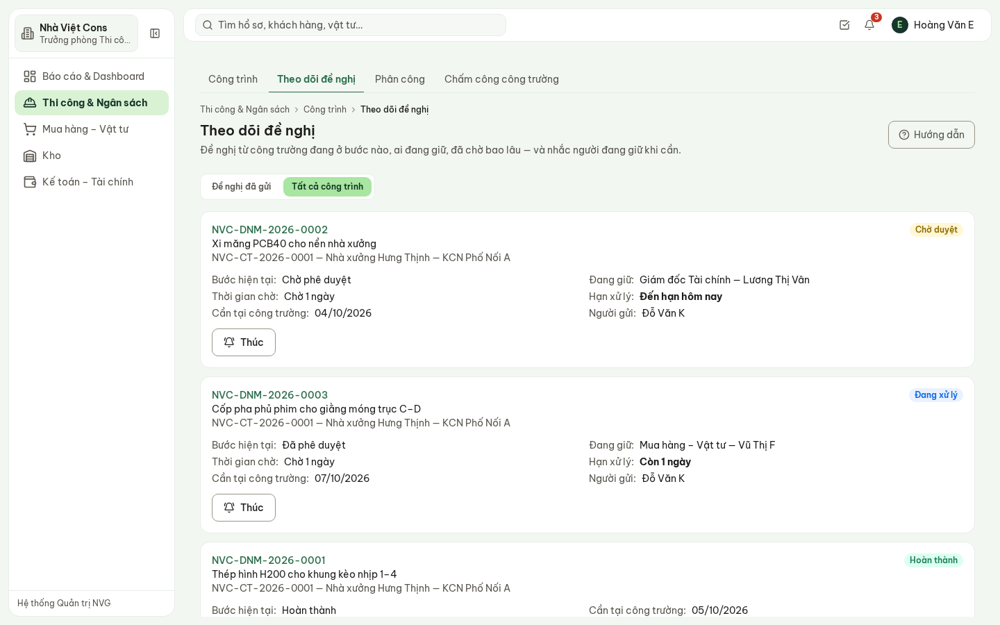

**Hình 9.** Xi măng PCB40 đang chờ Giám đốc Tài chính duyệt, đến hạn hôm nay; cốp pha đã duyệt,
đang ở Mua hàng.

Bấm **Thúc** với đề nghị đang chậm. Mục **Đề nghị đã gửi** chỉ hiện đề nghị do chính mình gửi.

## 6. Phân công người vào công trình

Chỉ huy trưởng và người ở hiện trường **chỉ thấy công trình được phân công**. Quên phân công thì họ
thấy **ít đi**, không thấy nhiều hơn.

**Phân công** → **Thêm phân công**:

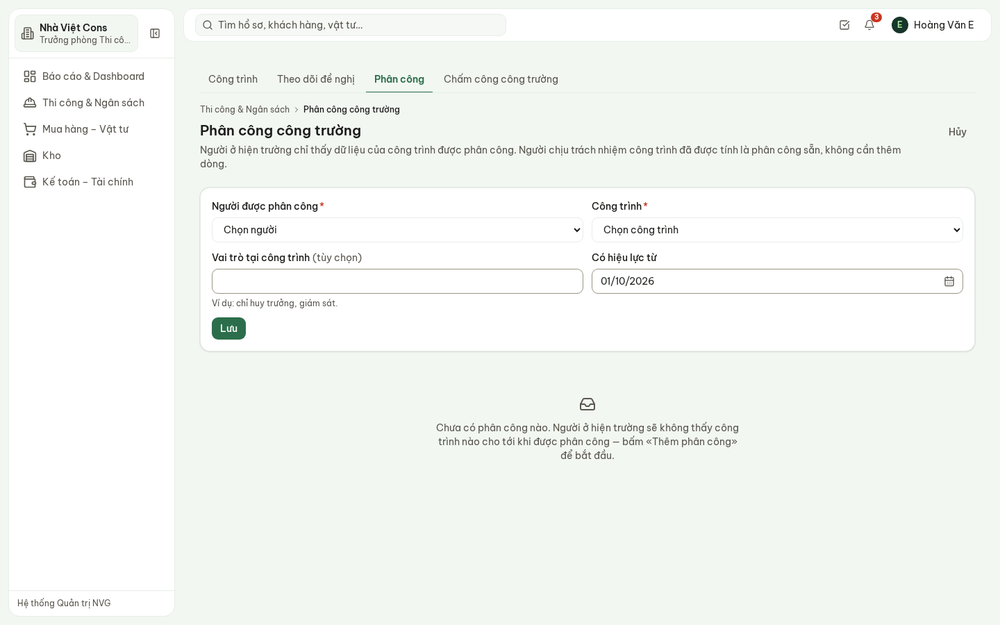

**Hình 10.** Thêm phân công: người, công trình, vai trò tại công trình, ngày hiệu lực.

- Người chịu trách nhiệm công trình (chỉ huy trưởng ghi trên công trình) **đã được tính là phân
  công**, không cần thêm dòng.
- Đổi người: bấm **Kết thúc** ở dòng cũ (hệ thống ghi ngày kết thúc, không xoá), rồi thêm phân công
  mới — vẫn tra lại được ai từng ở công trình nào trong khoảng nào.

## 7. Chấm công khối công trường

**Chấm công công trường**: chỉ hiện khối công trường. Hành chính – Nhân sự mở kỳ và chốt kỳ; Trưởng
phòng Thi công **xác nhận số liệu** của khối công trường.

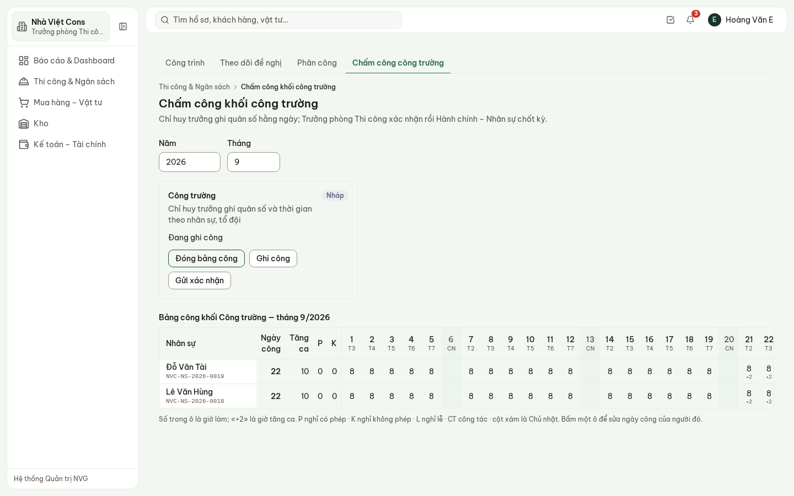

**Hình 11.** Kỳ tháng 9 đang ghi: bảng công Lê Văn Hùng, Đỗ Văn Tài — 22 ngày công, 10 giờ tăng ca.

1. **Ghi công**: chọn ngày và số giờ, ghi cho cả khối ngày đó (chỉ huy trưởng ghi được).
2. **Xem bảng công**: bảng người × ngày; bấm một ô để sửa ngày công của từng người (P nghỉ có
   phép, K nghỉ không phép, L nghỉ lễ, CT công tác; «+2» là giờ tăng ca).
3. **Gửi xác nhận** → **Xác nhận số liệu**. Đã gửi thì bảng công khoá.
4. Hành chính – Nhân sự chốt kỳ khi mọi khối có người làm việc đã xác nhận.

## 8. Phần chưa có trong bản demo

- Tiến độ chi tiết theo hạng mục (Gantt) — hiện chỉ có tiến độ tổng do chỉ huy trưởng đánh giá.
- Báo cáo so sánh nhiều công trình trên một trang (tiến độ, chi phí) — xem từng công trình.
- Quân số trong nhật ký chưa tự sang bảng chấm công; bảng công ghi theo từng người.
- Báo cáo lãi/lỗ theo công trình chỉ mở cho vai trò được xem giá vốn (Ban Giám đốc, Giám đốc Tài
  chính…).

## 9. Câu hỏi thường gặp

| Câu hỏi | Trả lời |
| --- | --- |
| Chỉ huy trưởng báo không thấy công trình? | Chưa được phân công. **Phân công** → **Thêm phân công**, hoặc ghi người đó làm người chịu trách nhiệm công trình. |
| Số «Đã phát sinh» lấy ở đâu? | Từ phiếu nhận hàng, xuất kho, đề nghị chi đã chi gắn mã công trình — không nhập tay. |
| Đề nghị vật tư kẹt lâu? | **Theo dõi đề nghị** cho biết đang ở ai; bấm **Thúc** để nhắc, lời nhắc được ghi lại. |
| Sửa biên bản nghiệm thu đã ký được không? | Không. **Hủy biên bản** kèm lý do rồi lập biên bản mới. |
| Không thấy nút xác nhận chấm công? | Khối công trường chưa **Gửi xác nhận**, hoặc kỳ chưa được Hành chính – Nhân sự mở. |
| Vì sao không xem được Lãi/lỗ? | Báo cáo dùng giá vốn — chỉ vai trò được cấp quyền xem lợi nhuận mở được. |
