# Hướng dẫn sử dụng — Quản trị hệ thống

Hệ thống Phần mềm Quản trị Nhà Việt Group · tài khoản, tham số, hạn mức phê duyệt, thời hạn xử lý, phân công công trường, nhật ký

| | |
| --- | --- |
| **Áp dụng cho** | Người quản trị hệ thống của Nhà Việt Group (vai trò **Quản trị hệ thống**) |
| **Thiết bị** | Máy tính |
| **Địa chỉ** | `https://nvg.tests99.workers.dev` |
| **Tài khoản demo** | `admin@nhavietgroup.test` — mật khẩu nhận riêng từ đầu mối dự án |
| **Phiên bản** | Bản dùng cho buổi trình diễn |

> Quản trị hệ thống **cấp và thu hồi quyền truy cập**, và **nhập các con số mà Nhà Việt Group đã
> quyết** (hạn mức phê duyệt, thời hạn xử lý, tham số vận hành). Quản trị viên không tự đặt ra các
> con số đó: mức đang chạy là mức tạm, chờ Ban Giám đốc ban hành. Mọi thay đổi đều có lịch sử,
> và **không làm thay đổi chứng từ đã phát hành**.

---

## 1. Quản trị hệ thống làm gì trên hệ thống

| Việc | Màn hình | Khi nào |
| --- | --- | --- |
| Cấp tài khoản cho người mới, ngừng tài khoản người nghỉ | **Người dùng** | Khi có người vào, người nghỉ |
| Nhập tham số vận hành (ngưỡng cảnh báo, số giờ công, giá…) | **Tham số hệ thống** | Khi Nhà Việt Group ban hành mức mới |
| Sửa mức tiền từng cấp duyệt | **Hạn mức phê duyệt** | Khi có quy chế phê duyệt mới |
| Nhập thời hạn phải xử lý đề nghị | **Thời hạn xử lý** | Khi Ban Giám đốc ban hành |
| Giao người vào công trình | **Phân công công trường** | Khi mở công trình, khi đổi người |
| Tra ai đã xem lương, giá vốn, lợi nhuận | **Nhật ký** | Khi cần kiểm tra |

Mở bằng mục **Quản trị hệ thống** ở thanh bên. Thanh dưới tiêu đề có bảy mục: **Người dùng** ·
**Tham số hệ thống** · **Hạn mức phê duyệt** · **Thời hạn xử lý** · **Biểu mẫu đầu bài** ·
**Phân công công trường** · **Nhật ký**.

Tổng Giám đốc cũng sửa được **Hạn mức phê duyệt** và **Thời hạn xử lý**; các mục còn lại chỉ
Quản trị hệ thống mở được.

## 2. Dashboard

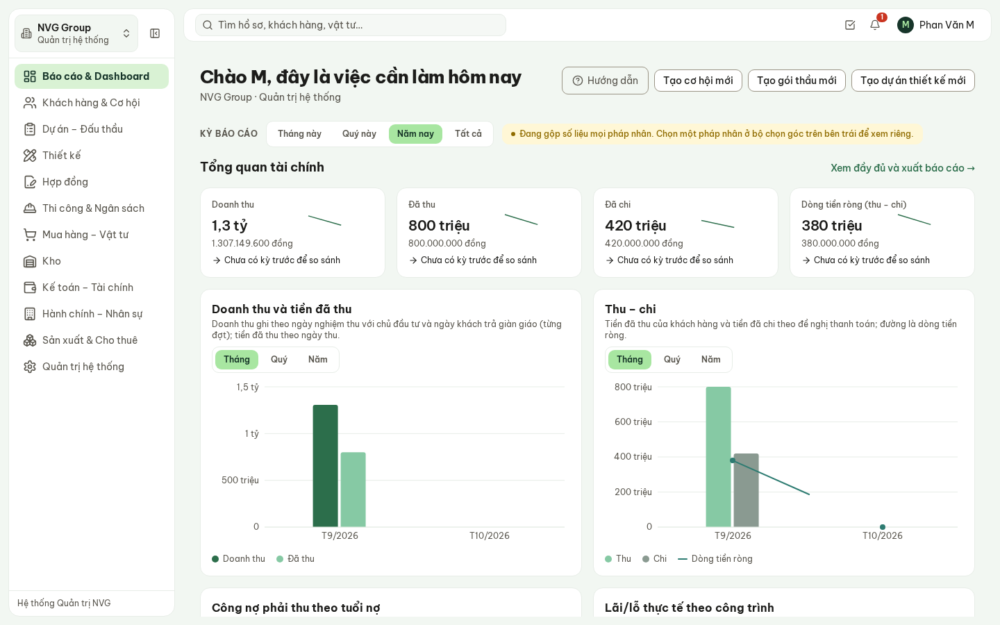

**Hình 1.** Quản trị hệ thống thấy số liệu của mọi pháp nhân, giống Ban Giám đốc.

Quản trị viên xem được mọi phân hệ để hỗ trợ người dùng khi họ báo lỗi. Việc quản trị nằm ở mục
**Quản trị hệ thống**, không ở Dashboard.

## 3. Người dùng

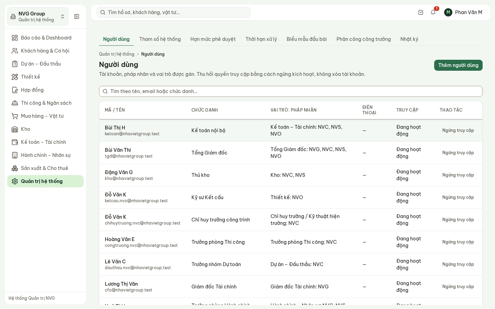

**Hình 2.** Mỗi dòng là một tài khoản: chức danh, vai trò ở từng pháp nhân, tình trạng truy cập.

- Cột **Vai trò: pháp nhân** liệt kê đủ mọi vai trò của một người. Ví dụ «Kế toán – Tài chính: NVC,
  NVS, NVO» là một người làm kế toán cho cả ba pháp nhân.
- Ô tìm kiếm tra theo tên, email hoặc chức danh.

### 3.1. Thêm người dùng

Bấm **Thêm người dùng**, điền họ tên, email đăng nhập, **pháp nhân** và **vai trò**. Chức danh,
phòng ban, điện thoại có thể bổ sung sau.

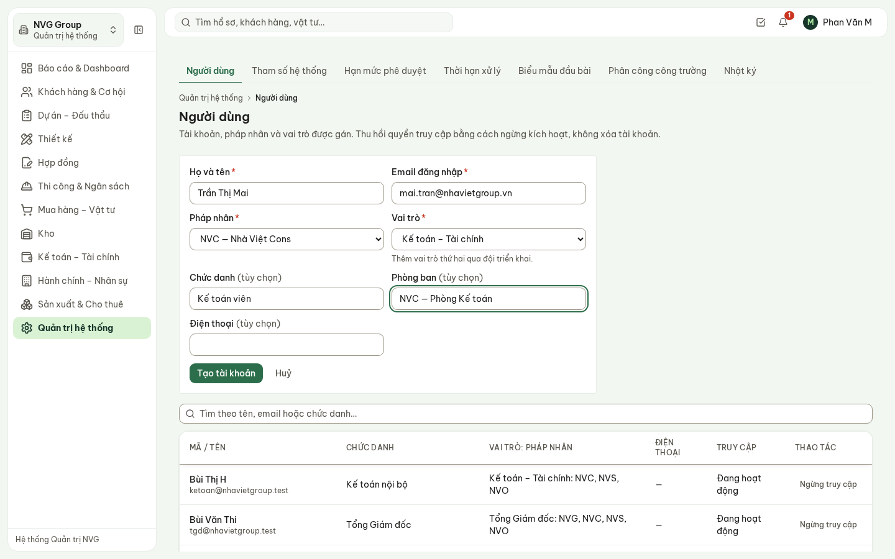

**Hình 3.** Cấp tài khoản cho một kế toán viên Nhà Việt Cons.

Bấm **Tạo tài khoản**. Hệ thống tạo tài khoản và sinh **mật khẩu tạm**:

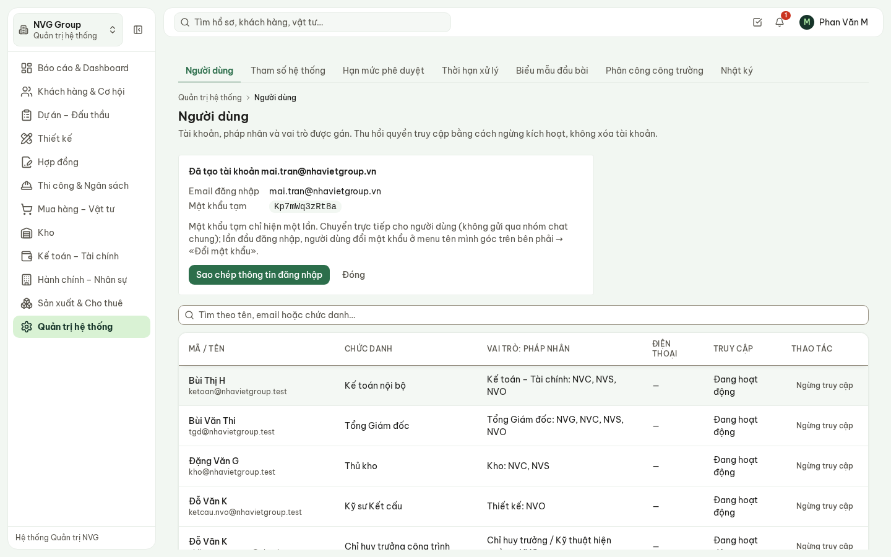

**Hình 4.** Mật khẩu tạm hiện **một lần duy nhất**. Bấm **Sao chép thông tin đăng nhập** để lấy
địa chỉ, email và mật khẩu tạm.

1. Chuyển thông tin đăng nhập **trực tiếp** cho người dùng, không gửi qua nhóm chat chung.
2. Lần đầu đăng nhập, người dùng bấm tên mình ở góc trên bên phải → **Đổi mật khẩu**.
3. Đóng khung này là mật khẩu tạm không xem lại được. Người dùng quên thì dùng **Quên mật khẩu**
   ở màn hình đăng nhập.

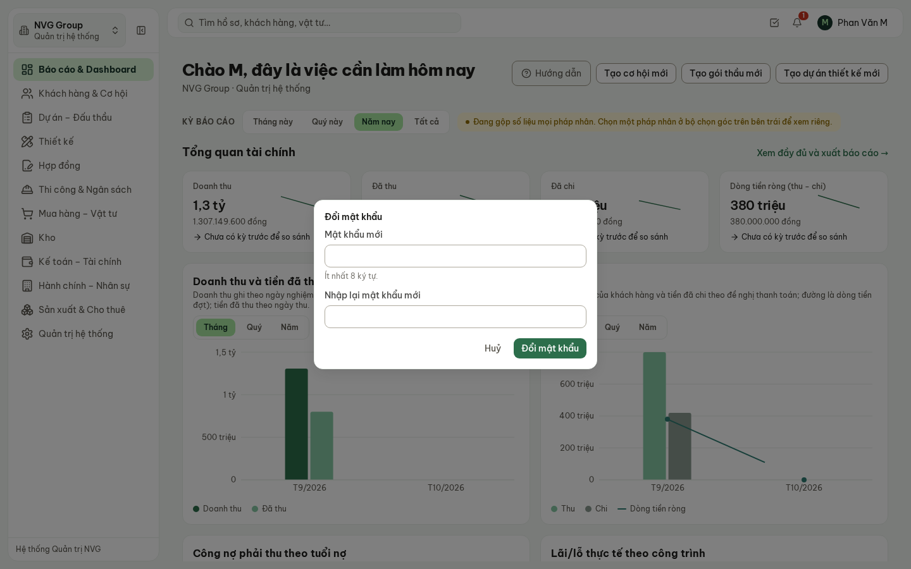

**Hình 5.** Người dùng tự đổi mật khẩu: ít nhất 8 ký tự, nhập hai lần.

> Mỗi tài khoản mới có **một vai trò chính**. Người kiêm nhiệm (ví dụ kế toán cho cả ba pháp nhân)
> cần thêm vai trò thứ hai: hiện do đội triển khai thực hiện.

Email đã có tài khoản thì hệ thống không tạo trùng mà báo «Email này đã có tài khoản».

### 3.2. Ngừng truy cập khi người nghỉ việc

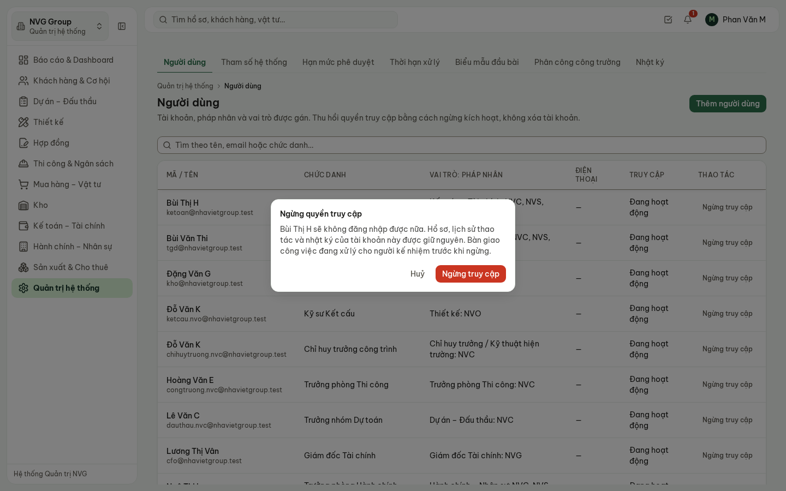

**Hình 6.** Ngừng truy cập: người đó không đăng nhập được nữa; hồ sơ và lịch sử giữ nguyên.

- Bấm **Ngừng truy cập** ở dòng của người đó, đọc hệ quả, bấm **Ngừng truy cập** lần nữa để xác nhận.
- Hệ thống **không xoá** tài khoản: mọi hồ sơ, phê duyệt, nhật ký người đó từng làm vẫn tra được.
- Trước khi ngừng: bàn giao việc đang xử lý cho người kế nhiệm. Hành chính – Nhân sự dựng danh sách
  bàn giao ở hồ sơ nhân sự (tab **Tiếp nhận, bàn giao**).
- Người quay lại làm việc: bấm **Mở lại truy cập**, các vai trò cũ còn nguyên.

## 4. Tham số hệ thống

Các con số vận hành do Nhà Việt Group quyết: ngưỡng cảnh báo sắp vượt ngân sách, số giờ một ngày
công, thời gian được sửa nhật ký công trường, giá thuê giàn giáo nội bộ, bảng giá bồi thường…

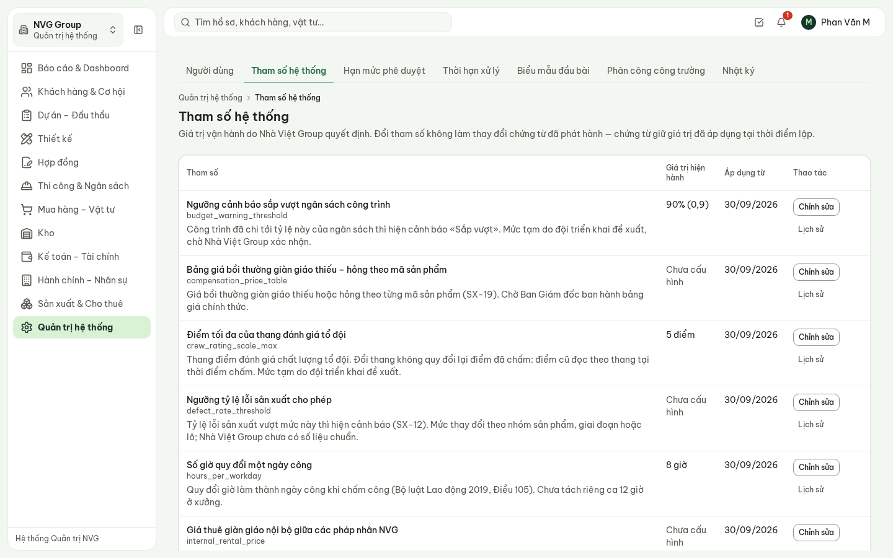

**Hình 7.** Mỗi tham số: tên, giá trị hiện hành, ngày áp dụng, và giải thích ai quyết.

- **Chưa cấu hình** nghĩa là Nhà Việt Group **chưa quyết** con số đó. Hệ thống cố ý để trống thay vì
  tự điền một con số trông như đã duyệt.
- Tham số tỷ lệ hiện dạng phần trăm kèm con số nhập: «90% (0,9)».
- Bấm **Lịch sử** để xem các lần đổi: giá trị cũ, giá trị mới, ngày áp dụng, người đổi.

**Sửa một tham số**: bấm **Chỉnh sửa**, biểu mẫu mở ngay bên dưới bảng.

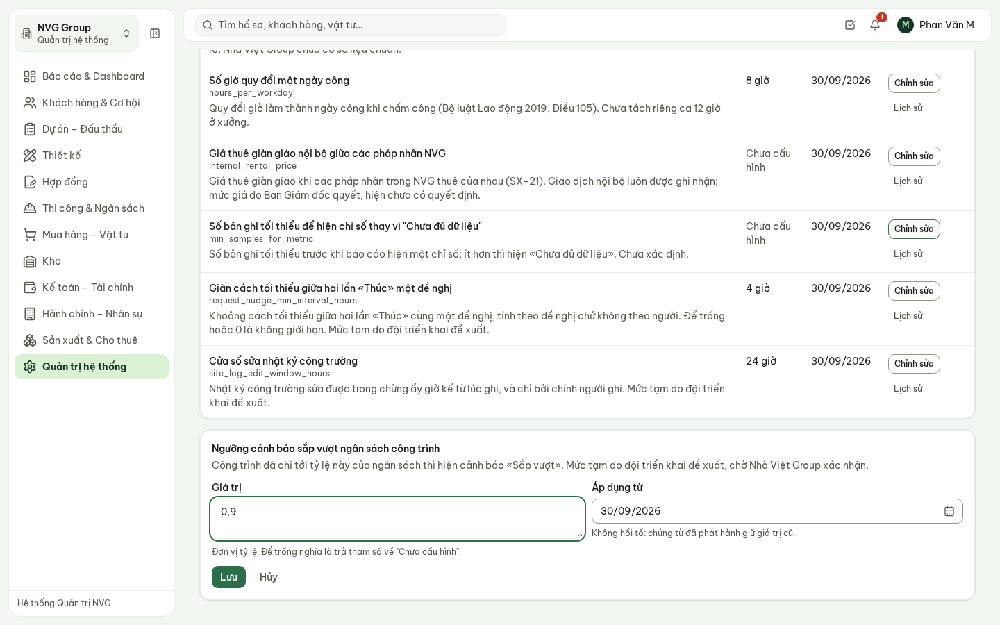

**Hình 8.** Sửa ngưỡng cảnh báo sắp vượt ngân sách: nhập giá trị và ngày áp dụng.

- Số thập phân dùng dấu phẩy, ví dụ `0,85`.
- **Áp dụng từ**: ngày bắt đầu có hiệu lực. **Không hồi tố**: chứng từ đã lập giữ giá trị đã dùng lúc
  lập.
- Xoá trống ô giá trị rồi lưu là trả tham số về «Chưa cấu hình» — dùng khi Nhà Việt Group rút lại
  một quyết định.

## 5. Hạn mức phê duyệt

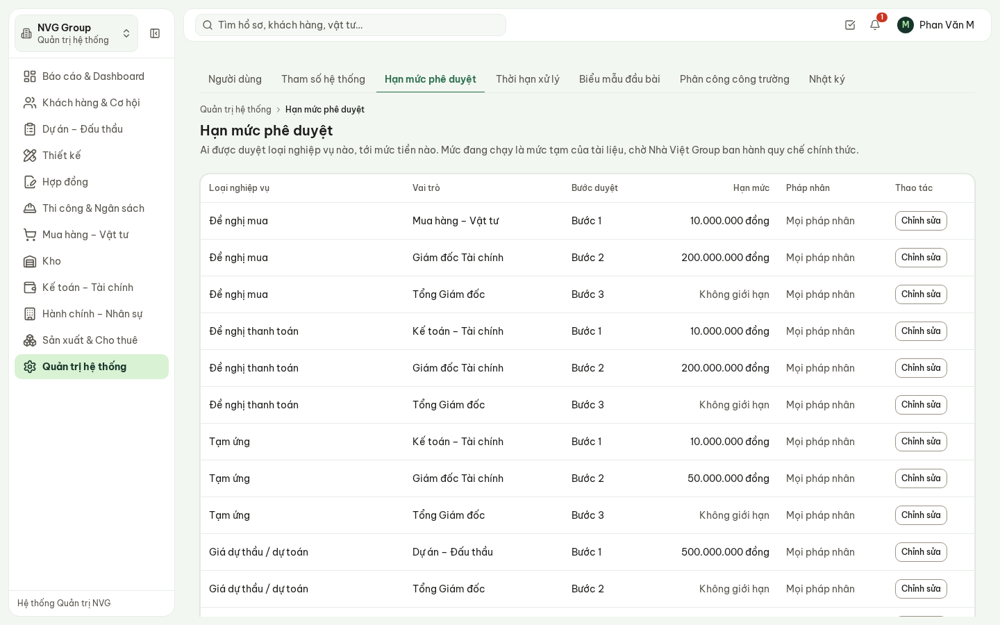

**Hình 9.** Mỗi loại nghiệp vụ có chuỗi duyệt nhiều bước; mỗi bước một vai trò và một mức tiền.

- Ví dụ đề nghị mua: Mua hàng duyệt tới 10 triệu, Giám đốc Tài chính tới 200 triệu, trên mức đó
  Tổng Giám đốc (**Không giới hạn**).
- Mức đang chạy là **mức tạm của tài liệu**, chờ Nhà Việt Group ban hành quy chế chính thức.
- **Chỉnh sửa**: đổi mức tiền, đánh dấu **Không giới hạn**, hoặc tắt dòng (bỏ vai trò đó khỏi chuỗi
  duyệt). Hồ sơ đang chờ duyệt giữ nguyên bước hiện tại.
- Thêm hay bớt một bước duyệt là đổi quy trình, không làm ở màn hình này — báo đội triển khai.

## 6. Thời hạn xử lý

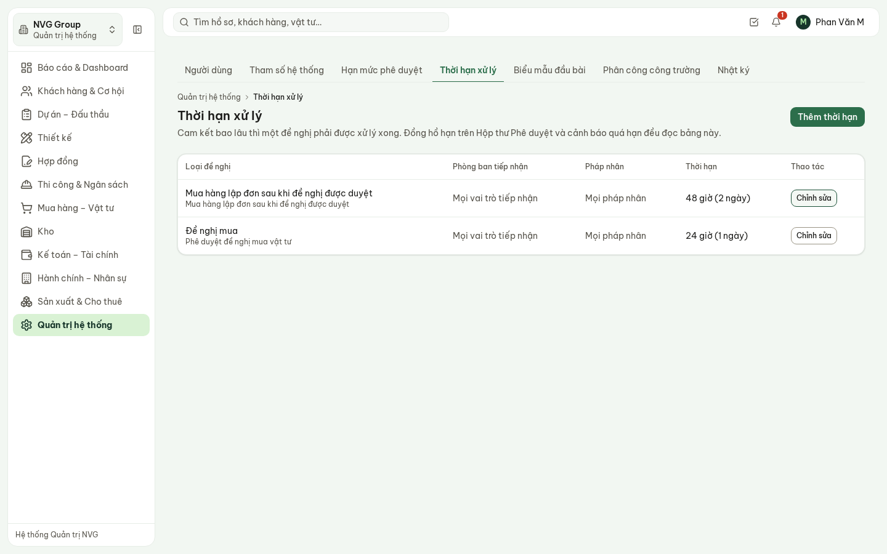

**Hình 10.** Thời hạn cam kết: đề nghị mua phải được phê duyệt trong 24 giờ; Mua hàng lập đơn trong
48 giờ sau khi đề nghị được duyệt.

- Đồng hồ hạn xử lý trên **Việc cần làm** và cảnh báo quá hạn ở **Theo dõi đề nghị** đều đọc từ bảng
  này. Loại đề nghị chưa có dòng nào thì **không có đồng hồ** — hệ thống không tự đặt hạn.
- **Thêm thời hạn**: loại đề nghị, số giờ cam kết (một ngày công là 8 giờ), phòng ban tiếp nhận,
  pháp nhân. Để trống phòng ban hoặc pháp nhân là áp dụng cho tất cả.
- Dòng hẹp hơn thay dòng rộng hơn: thời hạn riêng của một pháp nhân thay thời hạn chung.

## 7. Phân công công trường

Chỉ huy trưởng và người ở hiện trường **chỉ thấy công trình được phân công**. Quên phân công thì
họ thấy **ít đi**, không thấy nhiều hơn.

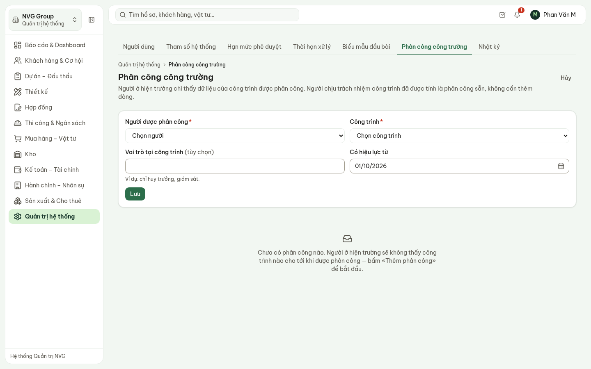

**Hình 11.** Thêm phân công: người, công trình, vai trò tại công trình, ngày hiệu lực.

- Người chịu trách nhiệm ghi trên công trình **đã được tính là phân công**, không cần thêm dòng.
- Đổi người: bấm **Kết thúc** ở dòng cũ (ghi ngày kết thúc, không xoá), rồi thêm phân công mới.
- Trưởng phòng Thi công cũng làm được việc này (xem hướng dẫn Trưởng phòng Thi công).

## 8. Nhật ký

Hai tab, chỉ đọc — không ai sửa hay xoá được nhật ký từ giao diện.

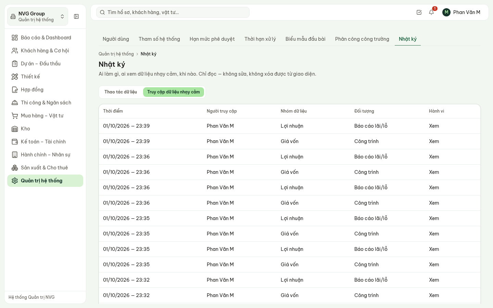

**Hình 12.** Truy cập dữ liệu nhạy cảm: ai xem hay sửa lương, giá vốn, lợi nhuận, lúc nào.

- **Truy cập dữ liệu nhạy cảm**: mỗi lượt mở bảng lương, hồ sơ cá nhân, giá vốn công trình, báo cáo
  lãi/lỗ đều được ghi lại, kể cả lượt của Ban Giám đốc và Quản trị viên.
- **Thao tác dữ liệu**: hiện chưa có nghiệp vụ nào ghi vào đây. Lịch sử sửa đổi của từng hồ sơ nằm ở
  tab **Lịch sử** trên màn hình chi tiết của hồ sơ đó.

## 9. Biểu mẫu đầu bài

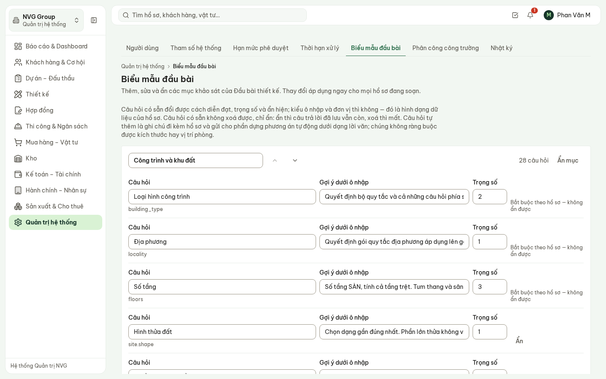

**Hình 13.** Sửa câu hỏi khảo sát của Đầu bài thiết kế.

Dành cho phòng Thiết kế, sửa theo đề nghị của trưởng phòng Thiết kế: đổi cách hỏi, gợi ý, thứ tự,
ẩn câu hỏi, thêm câu hỏi riêng. Câu hỏi có sẵn chỉ ẩn được, không xoá — câu trả lời cũ vẫn còn.
Thay đổi áp dụng ngay cho mọi hồ sơ đang soạn.

## 10. Phần chưa có trong bản demo

- Thêm vai trò thứ hai, đổi vai trò hoặc pháp nhân của một tài khoản đã có: do đội triển khai làm.
- Nhật ký **thao tác** xuyên mọi loại hồ sơ («hôm qua ai sửa gì»): chờ Nhà Việt Group quyết cần ghi
  những thao tác nào. Hiện tra theo từng hồ sơ ở tab **Lịch sử**.
- Thêm hoặc bớt một bước trong chuỗi phê duyệt: đổi quy trình, do đội triển khai làm theo quyết
  định của Nhà Việt Group.

## 11. Câu hỏi thường gặp

| Câu hỏi | Trả lời |
| --- | --- |
| Người mới đăng nhập vào chỉ thấy màn hình trống? | Kiểm tra cột **Vai trò: pháp nhân**. Người ở hiện trường còn cần **Phân công công trường**. |
| Người dùng làm mất mật khẩu tạm? | Dùng **Quên mật khẩu** ở màn hình đăng nhập, hoặc báo đội triển khai đặt lại. |
| Xoá tài khoản người đã nghỉ được không? | Không. **Ngừng truy cập** — lịch sử người đó làm phải tra lại được. |
| Đổi hạn mức có ảnh hưởng hồ sơ đang chờ duyệt? | Hồ sơ đang chờ giữ nguyên bước hiện tại; hồ sơ gửi sau theo mức mới. |
| Vì sao vài tham số «Chưa cấu hình»? | Nhà Việt Group chưa quyết con số đó. Ban Giám đốc ban hành rồi Quản trị viên nhập. |
| Đổi tham số có sửa lại chứng từ cũ? | Không. Chứng từ đã lập giữ giá trị đã áp dụng lúc lập. |
| Ai xem được nhật ký? | Màn hình **Nhật ký** chỉ Quản trị hệ thống mở được. Không ai sửa hay xoá được nhật ký. |
